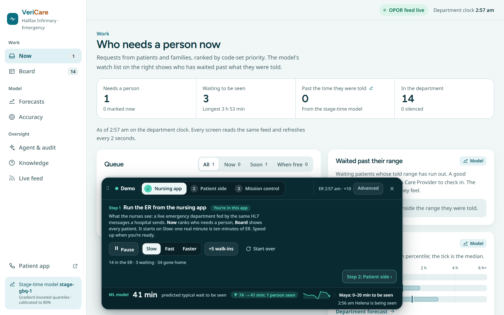
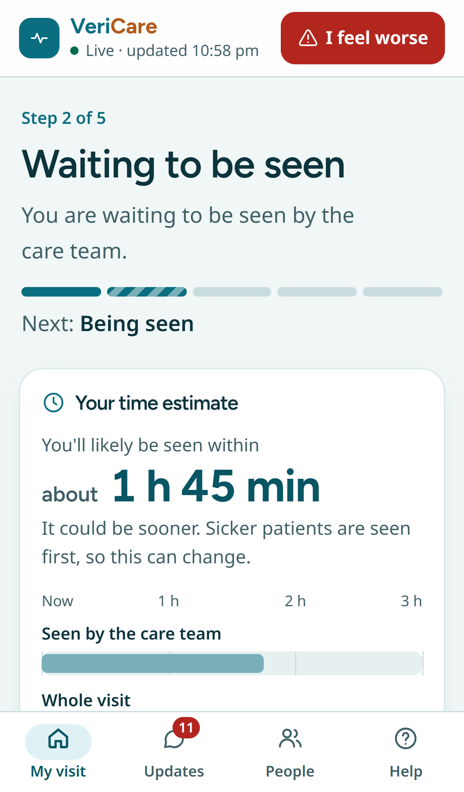
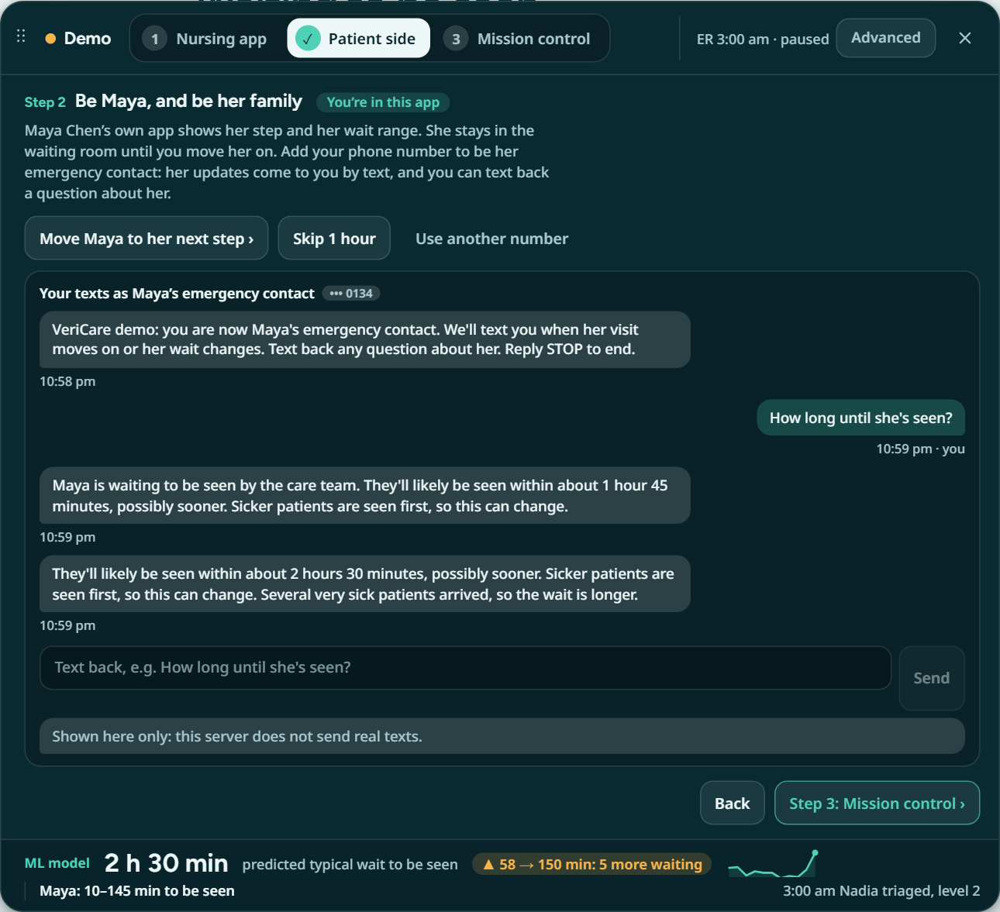
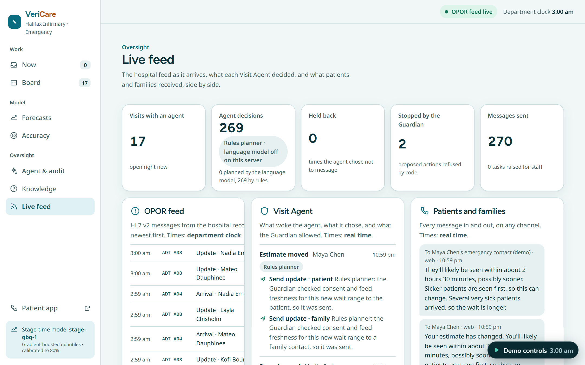
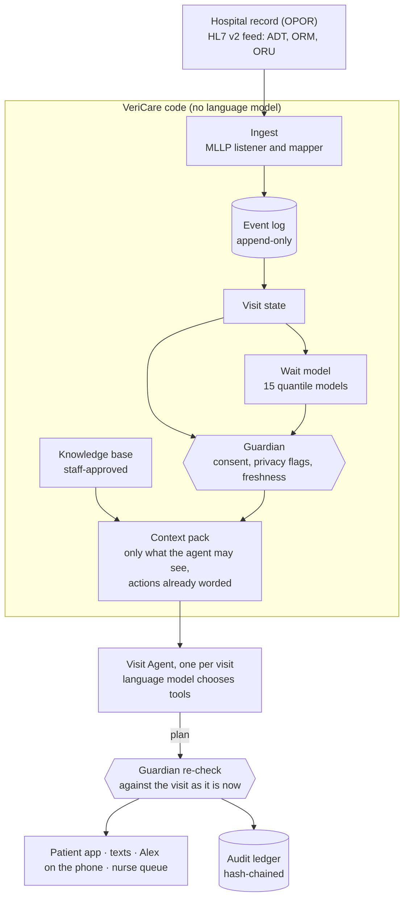
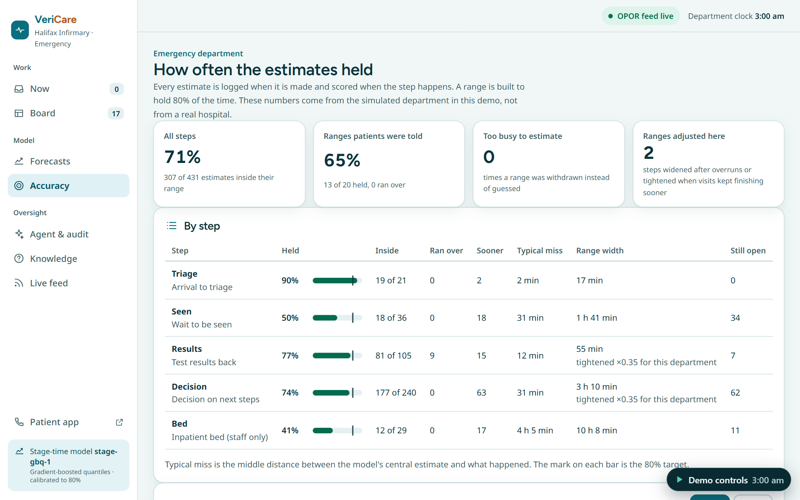

# VeriCare

**An agent for every hospital patient.**

VeriCare gives every patient in hospital their own AI agent. The agent tells them, and the family they choose, where they are in their care, what comes next and roughly how long it will take. It checks on them while they wait. Questions it must not answer go to the care team. It reads the events the hospital record already produces, so staff type nothing extra.

Our entry to the **Cognizant BrAInstorm Challenge 2026** ("Agentic AI for Good", Healthcare & Wellness). The demo is set in a Halifax emergency department, the sharpest case of the problem. Every patient, phone number and record in it is fictional.

|                 |                                                                                                                                                                    |
| --------------- | ------------------------------------------------------------------------------------------------------------------------------------------------------------------ |
| **Pitch video** | [pitch/VeriCare-pitch.mp4](pitch/VeriCare-pitch.mp4) in this repository                                                                                            |
| **Live demo**   | https://vericare-731923006486.us-central1.run.app (no install, no login)                                                                                           |
| **Code**        | https://github.com/Shivam7137/VeriCare                                                                                                                             |
| **Team**        | **VeriCare**: Shivam Shah ([Shivam7137@gmail.com](mailto:Shivam7137@gmail.com)) and Tenisha Bajagain ([tenibajagain17@gmail.com](mailto:tenibajagain17@gmail.com)) |



## Contents

1. [Review it in ten minutes](#review-it-in-ten-minutes)
2. [The problem](#the-problem)
3. [What VeriCare does](#what-vericare-does)
4. [How it works](#how-it-works)
5. [The agent](#the-agent)
6. [Privacy and security by design](#privacy-and-security-by-design)
7. [The machine-learning models](#the-machine-learning-models)
8. [Performance and scale](#performance-and-scale)
9. [Engineering and tests](#engineering-and-tests)
10. [What is real and what is simulated](#what-is-real-and-what-is-simulated)
11. [Impact and the path to a pilot](#impact-and-the-path-to-a-pilot)
12. [Questions judges ask](#questions-judges-ask)
13. [Every claim, and where to check it](#every-claim-and-where-to-check-it)
14. [Run it yourself](#run-it-yourself)

## Review it in ten minutes

The live demo is a working copy of the whole system on fictional data: the hospital feed, the wait model, the agent, the Guardian and all three apps. A **demo bar** at the bottom of the screen walks you through it in three steps. Each step opens one of the three apps:

| Step                   | App                        | Try this                                                                                                                                                                                                                                                                                                                                                         | What it shows                                                                                                                                                                                                                                     |
| ---------------------- | -------------------------- | ---------------------------------------------------------------------------------------------------------------------------------------------------------------------------------------------------------------------------------------------------------------------------------------------------------------------------------------------------------------- | ------------------------------------------------------------------------------------------------------------------------------------------------------------------------------------------------------------------------------------------------- |
| **1. Nursing app**     | `/professional/ed`         | Press **Start the ER**. It runs on **Slow**: one real minute is ten minutes of emergency department. Speed up with **Fast** when you like. Open **Board**, then click any patient's name.                                                                                                                                                                        | Patients arrive, are triaged, seen and sent home, driven by HL7 messages like the ones a hospital feed sends. Each visit shows its steps, its estimates and every decision its agent made.                                                        |
| **2. Patient side**    | `/patient/visit`           | Type a phone number (any fictional one, such as `902 555 0134`; the live demo sends no real texts). You are now Maya's emergency contact. Text back "How long until she's seen?". Press **Move Maya to her next step**. Maya waits in the waiting room until you move her; if she has gone home, **Re-seat Maya** brings her back without resetting anyone else. | Maya's own app with her step and her wait range. As her contact you get her updates in a text thread, and your question is answered within what she agreed to share.                                                                              |
| **3. Mission control** | `/professional/ed/mission` | Press **Surge: 5 urgent patients**.                                                                                                                                                                                                                                                                                                                              | Under the hood: each HL7 message, what each visit's agent decided, what the Guardian allowed, and every message sent. The wait model re-predicts everyone's wait, and the agent texts Maya and her contact the new range and the reason, unasked. |

Also try these:

- **The safety floor.** In Maya's app press **I feel worse**, then go back to the nursing app. A top-priority recheck is waiting under **Now**, raised by code before any model is asked.
- **The Guardian holding back what was not consented.** In step 2, untick **Maya shares her wait times with me** before adding your number. You get her steps but never a wait range, and **Agent & audit** records "Estimate withheld (no consent)" each time the Guardian holds one back.
- **The Guardian refusing.** On the **Board**, mark a patient **Confidential**. Their agent stops sending updates, and anyone asking about them gets the standard "please speak with the ER team", the same wording as for a transfer, so nothing is revealed. The Board's **Silenced** tab lists the visit, and the audit ledger under **Agent & audit** records each update the Guardian stopped.
- **Accuracy.** Open **Accuracy**. Every estimate the demo gives is logged and scored against what happened. When this department keeps finishing a later step (results, decision, bed) sooner than the model says, the ranges for that step are tightened to match, and the page shows by how much; repeated overruns widen them instead.
- **Every control.** **Advanced** on the demo bar opens speed, walk-ins, staffing, triage level and a per-patient **Next step**.

Notes on the live demo:

- It sleeps when nobody uses it, so the first load after a quiet spell takes about a minute, and it wakes to a fresh department.
- Everyone shares one department, and **Start over** resets it for everyone (you never need it for the guided steps: use **Re-seat Maya**). It also starts over on its own 30 minutes after the last use.
- Texts and calls are simulated. The agent plans with its **rules planner** there, because no model key is configured on the public copy. The language-model planner, the voice agent Alex and live texts run in our local setup and appear in the video. [Run it yourself](#run-it-yourself) to try them with your own keys.

To check the engineering, read [the agent](#the-agent), the [model card](ml/artifacts/MODEL_CARD.md) and [every claim, and where to check it](#every-claim-and-where-to-check-it).

## The problem

In 2023-24, **52,521 Nova Scotians (10.02% of 519,310 visits) left an emergency department without being seen**. The average wait from triage to a clinician was **2.96 hours** ([NS Department of Health and Wellness, Emergency Departments Accountability Report 2023-24](https://novascotia.ca/dhw/publications/emergency-departments-accountability-report-2023-24.pdf)).

The province's new shared health record, **One Person One Record (OPOR)**, records every visit as a stream of events: arrived, triaged, seen, tests ordered, results back, admitted, discharged. Today those events reach staff screens only. The patient in the waiting room and the family at home see none of it. So they phone the desk, wait without knowing why, or leave. Every "where is she?" call takes a nurse or clerk away from a patient.

**Why now.** OPOR went live at the IWK on 2025-12-06, in the Central Zone (including the QEII) on 2026-05-09, and in the Northern, Eastern and Western zones on 2026-11-14 ([Province of Nova Scotia](https://news.novascotia.ca/en/2025/12/04/one-person-one-record-launch-iwk), [NS Health implementation page](https://physicians.nshealth.ca/topics/nova-scotia-provider-digital-health-toolkit/one-person-one-record-opor/implementation)). For the first time, every visit in the province produces the same event stream. That stream is what VeriCare listens to.

**Who it is for.**

| Who              | Today                                                              | With VeriCare                                                                                       |
| ---------------- | ------------------------------------------------------------------ | --------------------------------------------------------------------------------------------------- |
| Patient          | Sits in the waiting room with no idea of their place or wait       | Their step, what comes next, a personal wait range, and check-ins while they wait                   |
| Family           | Calls the desk, or waits at home without news                      | Updates by text and a phone agent that verifies them first, within what the patient agreed to share |
| Nurse and clerk  | Answer status calls; find out late that someone felt worse or left | Fewer calls, and a short queue of who needs a person now                                            |
| Buyer: NS Health | Pays for walkouts, repeat visits and staff time on the phone       | A read-only add-on to the record it already runs                                                    |

**How this differs.** YourHealthNS publishes a predicted wait per site. A family is asking about one person: has she been seen, what is next, how much longer. That needs a verified caller, the patient's consent and patient-specific status, which a public page cannot give. Generic hospital chatbots answer from FAQs and know nothing about the visit. A call centre costs staff time. VeriCare gives each visit its own agent with its own calibrated estimate, under code-enforced privacy rules.

## What VeriCare does

Each visit gets a **Visit Agent**. It wakes on that visit's own events and does three jobs:

| Job         | What the agent does                                                                                                                                                   | Who it helps                                            |
| ----------- | --------------------------------------------------------------------------------------------------------------------------------------------------------------------- | ------------------------------------------------------- |
| **Inform**  | Tells the patient, and the family they approve, the current step, what comes next and a personal wait range from a trained model. It says why when the range changes. | Patients, families, and the staff who field their calls |
| **Protect** | Checks in while people wait ("same, better or worse?"), catches "I'm leaving", and puts the right patient in front of a nurse                                         | Patients and the triage nurse                           |
| **Relay**   | Takes questions it must not answer (medication, results) to the care team with a one-line summary, and answers practical questions from a library staff approve       | Families and nurses                                     |

The language model plans and chooses. **Code decides what may be disclosed, writes every sentence and produces every number.** If the model is down, the same approved messages still go out through a rules planner.

### Features, by person

|               | Feature                                                                                                                                                                          | Where                                                     |
| ------------- | -------------------------------------------------------------------------------------------------------------------------------------------------------------------------------- | --------------------------------------------------------- |
| **Patient**   | Their visit in five plain steps, what is next, and a personal wait range for the next step and the whole visit                                                                   | `/patient/visit`                                          |
|               | Timed check-ins tied to triage level; an **I feel worse** button that raises a top-priority nurse task                                                                           | `/patient/visit`                                          |
|               | Add family by phone number, choose what each may hear (status, alerts, estimates), and withdraw at any time                                                                      | `/patient/visit`                                          |
|               | Messages by app or text, with YES / STOP opt-in                                                                                                                                  | `apps/api/src/journey/sms.ts`                             |
| **Family**    | Texts when the visit moves on or the wait changes, and answers to texted questions                                                                                               | Demo bar step 2, `/family/<link>`                         |
|               | **Alex**, a voice agent that verifies the caller with a one-time code sent to the registered number, then gives status or relays a question. Alex follows the caller's language. | `apps/api/src/journey/voice.ts`, `emergency-lookup.ts`    |
| **Nurse**     | **Now**: a ranked queue of who needs a person (felt worse, about to leave, questions from family)                                                                                | `/professional/ed`                                        |
|               | **Board**: everyone in the department, their step, the next milestone the model expects, and a **Confidential** switch                                                           | `/professional/ed/board`                                  |
|               | The whole visit on one page: steps with times, every hospital event in plain words, ranges told and whether they held, contacts, tasks and agent decisions                       | Click any patient                                         |
|               | **Knowledge**: questions the library could not answer, ranked by how often they were asked; staff write and publish the answer once                                              | `/professional/ed/knowledge`                              |
| **Oversight** | **Mission control**: hospital feed, agent decisions and messages, live and side by side                                                                                          | `/professional/ed/mission`                                |
|               | **Accuracy**: every estimate scored against what happened; **Forecasts**: the next eight hours and the model card                                                                | `/professional/ed/accuracy`, `/professional/ed/forecasts` |
|               | **Agent & audit**: every agent run and the hash-chained audit ledger                                                                                                             | `/professional/ed/agent`                                  |

| Maya's app (patient)                                                                                                                                                          | Text thread as her emergency contact                                                                                                                                                         |
| ----------------------------------------------------------------------------------------------------------------------------------------------------------------------------- | -------------------------------------------------------------------------------------------------------------------------------------------------------------------------------------------- |
|  |  |

The thread on the right is real output from the demo, run with the public copy's settings (rules planner, texts shown on screen). The contact asked a question and got Maya's status. Then a surge arrived, and the agent sent the new range and the reason without being asked.

**Mission control**: the hospital feed (left), what each visit's agent decided and what the Guardian allowed (centre), and every message sent (right).



## How it works



1. **Events in.** VeriCare reads the HL7 v2 feed a hospital interface engine already emits, in Oracle Health's formats (ADT for arrival, updates, transfers, admission, discharge and cancellations; ORM and ORU for order and result status). It writes nothing back to the chart. For the demo, a simulated department sends the same messages over MLLP to the same listener.
2. **State is a projection.** Every message is stored in an append-only event log, de-duplicated by its control id. The visit's state is rebuilt from that log by a pure function, so replaying the log gives the same answer.
3. **Numbers come from a model, not the language model.** The wait model predicts the minutes to each step still ahead, with a calibrated range.
4. **The Guardian decides who may hear what.** It is plain code that checks consent, privacy markers (confidential, security alert, deceased), triage level and how fresh the feed is.
5. **Code builds the agent's input.** The context pack holds only what the agent may see, and the actions code has already prepared and worded.
6. **The agent plans.** It chooses among those actions by calling tools.
7. **Code checks again, then acts.** Each tool call is re-checked against the visit as it is now, so consent withdrawn mid-plan is honoured. Everything is written to a hash-chained ledger.

The agent never touches the database or the raw record. More: [system design](docs/design/vericare-journey-design.md), [OPOR interface mapping](docs/design/opor-patient-tracking.md), [shared contracts](docs/design/contracts.md).

## The agent

### What wakes it

| Wake               | Raised by                                                 | The agent can                                                                |
| ------------------ | --------------------------------------------------------- | ---------------------------------------------------------------------------- |
| `step_change`      | A feed message that moves the visit to a new step         | Send the prepared update to each approved contact, or hold it back           |
| `estimate_shift`   | The wait range moving past anti-jitter thresholds         | Send the new range and its reason, or hold it back                           |
| `check_in_due`     | A timer tied to triage level (15 to 60 minutes)           | Ask "same, better or worse?", put it off, or skip it                         |
| `inbound_message`  | The patient writing in the app or by text                 | Answer from the knowledge base, raise a staff task, give status, or hand off |
| `contact_question` | A contact writing by text, on the family page or by phone | The same, limited to what that contact may hear                              |

### Its tools, and the limits code enforces

| Tool                                       | Effect                                           | Limit enforced in code                                                                        |
| ------------------------------------------ | ------------------------------------------------ | --------------------------------------------------------------------------------------------- |
| `notify(action_id)`                        | Sends one prepared message                       | Must be an offered action; Guardian re-check; consent still active; rate limit on range texts |
| `ask_check_in()`                           | Sends the check-in question                      | Only when the timer says it is due                                                            |
| `open_staff_task(kind, priority, summary)` | Adds to the nurse queue                          | Recheck is always priority 1; the summary is refused if it holds numbers, links or addresses  |
| `answer_from_kb(article_id)`               | Replies with one approved article, word for word | Article must be published in that department                                                  |
| `report_knowledge_gap(topic)`              | Tells staff the library is missing an answer     | Topic is screened; nothing is sent to the person                                              |
| `handoff()`                                | "Please speak with the ER team"                  | Always allowed                                                                                |
| `schedule_wake(minutes)`                   | Puts a check-in off                              | 10 to 60 minutes, never past twice the interval                                               |
| `do_nothing()`                             | Logged restraint                                 | Not offered for a message: someone who wrote always gets a reply                              |

Each call carries a `why` sentence for the staff log, which patients never see.

### What the model cannot change

- **Safety floors run first, in code.** "Worse", chest pain, trouble breathing, fainting, bleeding, confusion and self-harm words open a top-priority recheck and send a fixed safety reply. "Leaving" opens a leaving task. Neither ever reaches the model.
- **People always hear what they must.** The patient always hears their own step change, their first range, a wait that has run past its range, and "too busy to estimate". A contact with the estimates scope always hears an overrun. A check-in twice overdue is always asked.
- **Restraint is a decision.** No more than one changed-estimate text per person per 30 minutes and six per visit. Holding back is logged like any other action.
- **Failure is safe.** Model calls time out after 8 seconds. On a timeout, an error, an empty plan or a plan the Guardian refused in full, the rules planner sends the same approved messages, and the fallback reason is logged.

### Answers from a library staff own (RAG)

Practical questions ("where can I charge my phone?") should not wait for a nurse, and should not be answered by a model making things up. Retrieval ranks staff-approved articles (BM25 with a synonym table, plus optional embeddings fused by reciprocal rank). The top three go into the context pack. The model **picks** an article and code sends its text word for word. When nothing matches, the agent reports a knowledge gap. Staff see the gaps ranked by how often they were asked, write the answer once and publish it. The next person who asks gets it.

### Alex, the voice agent

Alex answers family calls on a Twilio number with OpenAI's realtime voice. Its tools unlock in order: find the patient by name and birth date, check privacy flags, check the caller is a registered contact, send a one-time code to the registered number, verify it, and only then give status or relay a question. A silenced visit and a transfer sound identical, so a refusal reveals nothing.

More: [the Visit Agent, its tools and its knowledge base](docs/design/visit-agent.md), [the emergency-contact call](docs/demo/emergency-contact-demo.md), [call monitor](docs/design/call-monitor.md).

## Privacy and security by design

| Risk                                | What the code does                                                                                                                                                                                                         |
| ----------------------------------- | -------------------------------------------------------------------------------------------------------------------------------------------------------------------------------------------------------------------------- |
| The model seeing too much           | It never receives a name, birth date, phone number, triage level, reason for visit, order or result. A silenced visit raises no work for the model at all.                                                                 |
| Disclosure to the wrong person      | The Guardian decides every disclosure in plain code, before planning and again when the plan is applied. It fails closed: any doubt becomes a neutral reply or the standard hand-off, worded the same whatever the reason. |
| Prompt injection                    | The model only chooses among actions code prepared. It never writes a fact, a number or a message body. Text from the public is labelled as data.                                                                          |
| A sicker patient waiting on a model | Danger words raise a top-priority nurse task in code before any model is asked.                                                                                                                                            |
| Impersonation on the phone          | Alex's status and relay tools unlock only after a one-time code sent to the number on file, with expiry, single use and a retry limit.                                                                                     |
| Tampering                           | The event log and the audit ledger are append-only (database triggers refuse updates and deletes), and each ledger row is hash-chained to the one before it.                                                               |
| Forged webhooks                     | Every inbound text and delivery report must carry a valid Twilio signature. A text from an unknown number gets no reply at all.                                                                                            |
| Leaked family link                  | Only a SHA-256 hash of the link is stored, withdrawal kills it at once, and it shows the step only.                                                                                                                        |
| Stale data                          | If the feed has been silent for 15 minutes, VeriCare gives the standard hand-off instead of a status that may be out of date.                                                                                              |

**The legal boundary.** Nova Scotia's PHIA section 37 lets a custodian tell family, in general terms, about a patient's presence, location and general condition on the day, unless the patient objects. A personal wait range goes beyond "general terms", so VeriCare asks for the patient's express consent per contact and per scope (status, alerts, estimates), and records it ([our privacy research](docs/research/04-privacy-legal-compliance.md)).

**Not done yet, and needed before real patients:** a privacy impact assessment with NS Health, Canadian hosting for speech and the language model (today OpenAI and Twilio process data outside Canada), and an external security review. More: [security, scale and performance summary](docs/reports/security-scalability-summary.md), [threat model](docs/research/05-security-threat-model.md), [SECURITY.md](SECURITY.md).

## The machine-learning models

| Model                                                       | Job                                                                       | Where it runs                                              |
| ----------------------------------------------------------- | ------------------------------------------------------------------------- | ---------------------------------------------------------- |
| **Stage-time model `stage-gbq-1`** (ours)                   | Minutes until each step ahead, as a calibrated low / typical / high range | Inside the API, from exported trees: no ML runtime         |
| OpenAI `gpt-6-luna` (configurable with `VISIT_AGENT_MODEL`) | Visit Agent planning through tool calls                                   | OpenAI API, behind the Guardian; rules planner as fallback |
| OpenAI `gpt-live-1`                                         | Alex's real-time voice                                                    | Twilio Media Streams to the OpenAI realtime API            |
| OpenAI `text-embedding-3-small` (optional)                  | Knowledge-base search alongside BM25                                      | Off by default (`KB_EMBEDDINGS=true`)                      |

### The wait model

**What it predicts.** For every open visit, the minutes until each milestone still ahead: triage, being seen, test results, a decision on next steps, and an inpatient bed. It is **15 gradient-boosted quantile models** (5 steps × the 10th, 50th and 90th percentiles; scikit-learn `HistGradientBoostingRegressor` with quantile loss). Ranges are calibrated by conformalized quantile regression per triage band and time of day, so each range should hold about 80% of the time. It uses **47 inputs, all computable from the hospital feed alone**, so the path from demo to pilot needs no new data entry.

**What it learned from.** No public dataset holds both step-by-step timestamps and the live queue of a Canadian emergency department. So each source is used only for what it can support:

| Source                                                                     | Used for                                                                                                                                                              |
| -------------------------------------------------------------------------- | --------------------------------------------------------------------------------------------------------------------------------------------------------------------- |
| **NHAMCS 2018-2022** (US CDC): 86,864 real emergency visits, 50,258 usable | Who arrives, what is ordered, how visits end, and real time from first provider contact to the end of the visit. Every simulated patient is one of these real visits. |
| **MIMIC-IV-ED demo**: 200 stays with bloodwork                             | Real lab turnaround (blood collected to result: hematology 33 min, chemistry 62 min, troponin 58 min)                                                                 |
| **Published Canadian figures**                                             | Calibration targets and turnaround anchors                                                                                                                            |
| **A simulated department**                                                 | The shared queue, which no open data supplies: triage nurses, a main and a rapid-assessment stream, provider and bed limits, walkouts                                 |

**Calibrated to Nova Scotia.** The reference department reproduces the published figures:

| Figure                            | Published                                    | Simulated |
| --------------------------------- | -------------------------------------------- | --------- |
| Average wait, triage to clinician | 178 min (NS 2023-24)                         | 179 min   |
| Left without being seen           | 10.0% (NS 2023-24)                           | 10.1%     |
| Average wait for an inpatient bed | 780 min (Ontario 2022-23; NS publishes none) | 794 min   |

**Trained to generalise.** Volume (70 to 280 visits a day), acuity mix, staffing, beds, queue rules, lab speed and surge frequency are randomised, so the model learns how a queue turns into a wait instead of one department's habits. Departments are split whole: 72 for training, 25 for calibrating ranges, and the rest held out.

**Results on 12 simulated departments it never saw:**

| Step                   | Range held (target 80%) | Ran over (target 10%) | Typical error | Better than a lookup table by |
| ---------------------- | ----------------------- | --------------------- | ------------- | ----------------------------- |
| Arrival to triage      | 79.1%                   | 11.0%                 | 7 min         | 23%                           |
| Wait to be seen        | 78.6%                   | 10.7%                 | 53 min        | 64%                           |
| Test results back      | 80.5%                   | 9.8%                  | 38 min        | 16%                           |
| Decision on next steps | 79.9%                   | 9.9%                  | 139 min       | 18%                           |
| Inpatient bed          | 80.3%                   | 10.8%                 | 383 min       | 47%                           |

**Why gradient-boosted trees.** On the same departments and loss, a three-layer neural network landed within 6% of the trees on every step (5.6% better on the wait to be seen). A linear quantile model was 54% worse where the queue matters. Trees were kept because they reach the same accuracy while taking missing values as they come and needing no feature scaling. The API evaluates them itself with no ML server, and they hold up better on the small real datasets a pilot starts with. Python and TypeScript feature code are held together by a fixture test.

**The honest caveat.** Those numbers are measured on departments from the same simulator, built from real patients. They show the method works and the ranges are calibrated. They do not show accuracy at a Nova Scotia hospital. On the one out-of-distribution check available, the scripted demo department, the wait range held 56% to 71% of the time. Before telling real patients a number, the models must run silently against a real feed and be retrained on it with this same code. Every estimate the demo gives is already logged and scored (`ed_stage_estimates`, the **Accuracy** page). That scoring also corrects the model for the department it runs in: when visits there keep reaching results, a decision or a bed sooner than the range said, those ranges are scaled down to match (on a 12-hour simulated shift, decisions went from 50% to 95% inside their range, with ranges a third as wide); repeated overruns widen them instead. The wait to be seen, which is what patients are told, is left as trained. See [section 11.5 of the build record](docs/design/stage-time-model.md#115-local-recalibration-experiment-p5). The model card also covers the bed stage, ESI versus CTAS, censoring of walkouts, and why we do not quote the gain over rolling averages.



More: [model card](ml/artifacts/MODEL_CARD.md), [build record and experiments](docs/design/stage-time-model.md), [training code](ml/), [raw metrics](ml/artifacts/metrics.json), [model comparison](ml/artifacts/model_comparison.json).

## Performance and scale

| Measure                          | Result                                                                              | Reproduce                                                                                                                    |
| -------------------------------- | ----------------------------------------------------------------------------------- | ---------------------------------------------------------------------------------------------------------------------------- |
| Language-model plan per decision | 1.6 s mean, 2.2 s at the 90th percentile, 2.8 s max (37 plans, 2026-11-16)          | `SELECT avg(latency_ms), percentile_cont(0.9) WITHIN GROUP (ORDER BY latency_ms) FROM ed_agent_runs WHERE planner = 'model'` |
| Model outage                     | 8 s timeout, then the rules planner, logged with the reason                         | `apps/api/src/agents/llm.ts`, `apps/api/test/integration/visit-agent.test.ts`                                                |
| Updates people must get          | Sent in the same transaction as the hospital message, without waiting for the model | `apps/api/src/journey/ingest.ts`                                                                                             |
| Three-hour scenario              | 96 HL7 messages and 344 ledger rows, played in under a minute                       | `npm run twin`                                                                                                               |
| Wait model                       | Evaluated inside the API process from exported trees                                | `apps/api/src/journey/stage-model.ts`                                                                                        |

**Scale.** Work grows with events, not with the size of the department, because each visit's agent wakes only on its own events. The hospital record stays the source of truth, and VeriCare's state can be rebuilt by replaying its log. Resent feed messages and texts are harmless: they are keyed by control id and provider id, and that is tested. **The current limit:** one API process plans the agent's work, with claims held in memory. Running several processes needs a database claim on each wake (`FOR UPDATE SKIP LOCKED`, the pattern the text sender already uses). The model call is stateless, so it scales out with processes. The estimated running cost is about **C$0.50 per enrolled visit** (C$0.30 to C$0.80): mostly about eight texts per visit, plus one family call for every three visits. This is a planning estimate from published prices, not a measurement ([cost model](docs/research/07-challenge-and-stakeholders.md)).

## Engineering and tests

|                |                                                                                                                                                    |
| -------------- | -------------------------------------------------------------------------------------------------------------------------------------------------- |
| **Stack**      | TypeScript on Node.js 24; Next.js 16 and React 19 (apps); Fastify 5 (API); PostgreSQL 17; Twilio; OpenAI; Python with scikit-learn (training only) |
| **Tests**      | **220 unit tests** and **246 database tests**, all passing (2026-11-18). Database tests run in isolated schemas against a real PostgreSQL.         |
| **Checks**     | `npm run check` runs formatting, type checks, unit tests and the production build                                                                  |
| **Data model** | 17 additive, ordered migrations; append-only triggers on the event log and the ledger                                                              |
| **Deployment** | One container (PostgreSQL, API, worker, web) on Google Cloud Run, scaled to zero; [how it is hosted](docs/setup/hosting.md)                        |

The hardest parts, and where they live:

- **HL7 v2 ingest** with a per-site mapper, because triage level and privacy markers have no standard field in Oracle Health's feed: `apps/api/src/opor/`
- **Event-sourced visit state** that replays to the same answer: `apps/api/src/journey/visit-state.ts`
- **A Guardian in plain code**, unit-tested case by case: `apps/api/src/journey/guardian.ts`, `apps/api/test/journey-core.test.ts`
- **An agent loop with a re-check and a rules fallback**: `apps/api/src/agents/`
- **A calibrated model served without an ML runtime**: `apps/api/src/journey/stage-*.ts`, `ml/vericare_ml/`
- **A demo director** that plays a whole department through the same feed path, so the model, the agent and the apps react exactly as they would to a hospital: `apps/api/src/journey/demo/`

## What is real and what is simulated

| Real, working code                                                                          | Simulated or not yet done                                                                                        |
| ------------------------------------------------------------------------------------------- | ---------------------------------------------------------------------------------------------------------------- |
| HL7 v2 parsing, MLLP listener and mapping, in Oracle Health's formats                       | The hospital feed: a simulated department sends the messages (there is no public OPOR feed)                      |
| The event log, visit state, Guardian, agent loop, rules fallback, knowledge base and ledger | Every patient, record and phone number                                                                           |
| The wait model, trained on real US visits and real lab times                                | The shared queue it learned from, and its accuracy (measured on simulated departments)                           |
| Patient app, nursing app, mission control, accuracy, knowledge pages                        | A patient-set confidentiality switch, illustrated in the video (only the staff **Confidential** switch is built) |
| Language-model planning (run live, 2026-11-16) and Alex on a real phone call (in the video) | Language model, voice and live texts on the public demo (rules planner and simulated texts there)                |
| Texts through Twilio with signed webhooks (local setup)                                     | Privacy impact assessment, Canadian hosting, external security review                                            |

## Impact and the path to a pilot

**The return, as a projection.** Nurse and clerk time saved = status calls avoided × minutes per call × loaded staff cost × departments. We have not measured it yet, and the pilot's baseline is there to measure it. Comparable evidence: in one intensive care unit, structured updates to families cut inbound calls from 3.26 to 0.33 per family with no loss of satisfaction ([Relias Media](https://reliasmedia.com/articles/59308-structured-communication-program-for-family-members)). The **Protect** loop aims at walkouts: Nova Scotia already funds Waiting Room Care Providers, and VeriCare gives them a queue of who needs them next.

**The path to a pilot at one Halifax emergency department:**

1. **Baseline (2 to 4 weeks).** Count status calls, walkouts and time to recheck after "worse". Complete the privacy impact assessment with NS Health and move speech and the model to Canadian hosting.
2. **Shadow (read-only).** Connect to the real HL7 feed. VeriCare predicts and plans but tells no one. Every estimate is scored, and the models are retrained on OPOR history with this same code.
3. **Live, with consent.** Patients opt in by text. Measure calls answered without staff, range coverage, and time to recheck.

The ER is the hardest case. The same per-visit agent runs on the same admit, transfer and discharge events on the wards and after discharge.

## Questions judges ask

**The wait model trained on simulated data. Why trust it?**
No open dataset has a live Canadian ER queue, so we combined real US visits, real lab times and Nova Scotia's published figures in a simulated ER calibrated to them. On 12 simulated departments it never saw, the 80% ranges held 78.6% to 80.5% of the time. That proves the method, not real-world accuracy. The pilot's shadow step measures that, and every estimate is already logged for it.

**What stops the AI telling the wrong person?**
The model never decides what is disclosed. The Guardian, in plain code, checks consent, privacy flags and feed freshness before planning and again when the plan is applied. The model only picks among actions code prepared, so it cannot write a fact or a number.

**How do you know the caller is really family?**
The caller must be a contact the patient registered, and the status tools unlock only after a one-time code goes to that contact's number on file. An unknown caller, a confidential record and a patient who is not there all get the same calm reply.

**Isn't this a workflow script with an LLM on top?**
Each visit has its own agent that wakes on its own events and decides whether anyone needs to hear about it. Most of the time it decides not to, and that restraint is logged. When a surge moves a wait, it texts the patient and family with the reason, unasked. Code sets the limits it cannot cross.

**What does the AI see about the patient?**
No name, birth date, phone number, triage level, reason for visit or result. For a silenced visit, nothing at all.

**Where does the data go? Is it PHIA-ready?**
Not yet, and we say so. Today OpenAI and Twilio process outside Canada. Before real patients: a privacy impact assessment, Canadian hosting and an external security review.

**How does it plug into the hospital?**
It reads the HL7 feed OPOR already emits and writes nothing to the chart. Nurses get nothing new to learn: the queue replaces calls they already take.

**What if the model is down or wrong?**
Required updates go out in the same transaction as the hospital message, without the model. Model calls time out after 8 seconds and the rules planner takes over. Danger words reach a nurse in code before any model is asked.

**How does it scale to a province?**
Work grows with events, not with department size. Resent messages change nothing. The next step for several API processes is a database claim per wake, already used by the text sender.

**You say "every hospital patient", but you built the ER.**
The ER has the most uncertainty, the most calls and the least staff time, so it is the hardest test. The same agent runs on the same admit, transfer and discharge events everywhere else.

## Every claim, and where to check it

| Claim                                                   | Code                                                                        | Test or evidence                                                                          |
| ------------------------------------------------------- | --------------------------------------------------------------------------- | ----------------------------------------------------------------------------------------- |
| Code, not the model, decides disclosure                 | `apps/api/src/journey/guardian.ts`                                          | `apps/api/test/journey-core.test.ts`                                                      |
| The model never sees identity or clinical details       | `apps/api/src/agents/wake.ts` (`contextPack`)                               | `apps/api/test/integration/visit-agent.test.ts`                                           |
| Plans are re-checked; failures fall back to rules       | `apps/api/src/agents/`                                                      | `apps/api/test/integration/visit-agent.test.ts`, `apps/api/test/visit-agent-core.test.ts` |
| Danger words reach a nurse before any model             | `apps/api/src/journey/tasks.ts`, `intake.ts`                                | `apps/api/test/integration/journey.test.ts`                                               |
| Event log and ledger are append-only and hash-chained   | `apps/api/migrations/012_ed_journey.sql`, `apps/api/src/journey/records.ts` | `apps/api/test/integration/journey.test.ts`                                               |
| Resent feed messages are harmless                       | `apps/api/src/journey/ingest.ts`                                            | `apps/api/test/integration/journey.test.ts`                                               |
| HL7 v2 in Oracle Health's formats                       | `apps/api/src/opor/`                                                        | `apps/api/test/opor-mapper.test.ts`                                                       |
| Calibrated ranges, 78.6% to 80.5% on unseen departments | `ml/vericare_ml/`                                                           | `ml/artifacts/MODEL_CARD.md`, `metrics.json`                                              |
| Trees versus neural network versus linear               | `ml/vericare_ml/compare_models.py`                                          | `ml/artifacts/model_comparison.json`                                                      |
| The model runs inside the API, matching Python          | `apps/api/src/journey/stage-model.ts`                                       | `apps/api/test/stage-model.test.ts`                                                       |
| One-time code before Alex gives status                  | `apps/api/src/emergency-lookup.ts`, `apps/api/src/journey/voice.ts`         | `apps/api/test/integration/emergency-lookup.test.ts`                                      |
| Signed Twilio webhooks only                             | `apps/api/src/twilio-provider.ts`, `voice-sms-routes.ts`                    | `apps/api/test/twilio-provider.test.ts`                                                   |
| Knowledge base answers word for word, gaps reach staff  | `apps/api/src/agents/knowledge.ts`, `retrieval.ts`                          | `apps/api/test/knowledge-core.test.ts`, `integration/knowledge.test.ts`                   |
| Eight edge-case visits end where they should            | `apps/api/src/twin/featured.ts`                                             | `apps/api/test/integration/featured.test.ts`                                              |
| The guided demo and the judge's emergency contact       | `apps/api/src/journey/demo/`, `apps/web/components/demo-steps.tsx`          | `apps/api/test/integration/demo-director.test.ts`                                         |

## Run it yourself

The full step-by-step guide, with troubleshooting and a section for coding agents, is [SETUP.md](SETUP.md). The short version: you need Node.js 24 and Docker Desktop with its Linux engine running. From the repository root:

```sh
npm ci
npm run setup          # creates .env (keeps an existing one)
npm run db:up
npm run db:migrate
npm run db:seed
npm run demo:populate
npm run demo:credentials
npm run dev            # API on 4100, web app on 3100, worker
```

Open http://127.0.0.1:3100/professional/ed and use the demo bar. Every page signs in with a fictional demo account, and development servers listen on loopback only.

- **Language-model planning:** set `OPENAI_API_KEY` and `VISIT_AGENT_ENABLED=true` in `.env`. A key alone never turns the model on.
- **Real texts:** set the Twilio values and `JOURNEY_SMS_ENABLED=true`. Texts go only to numbers on `VOICE_ALLOWED_NUMBERS`. With `*` on that list, anyone using the demo can make it text any number, so keep `*` for supervised use.
- **Alex on the phone:** [phone setup](docs/setup/phone-setup.md) and [the emergency-contact call](docs/demo/emergency-contact-demo.md).
- **Retrain the model:** see [reproducing the models](docs/design/stage-time-model.md#17-reproducing-this).

```sh
npm test               # 220 unit tests: API, web, contracts, scripts
npm run test:backend   # 246 database tests in isolated schemas (needs Docker and .env)
npm run check          # formatting, typecheck, unit tests and build
```

### Repository layout

| Path                            | Purpose                                                                                               |
| ------------------------------- | ----------------------------------------------------------------------------------------------------- |
| `apps/web`                      | Next.js apps: nursing app, patient app, family page, mission control, call monitor, demo bar          |
| `apps/api/src/journey`          | The visit pipeline: feed ingest, visit state, estimates, Guardian, messages, texts, the demo director |
| `apps/api/src/agents`           | The Visit Agent: planner, tools, model client, knowledge base and retrieval                           |
| `apps/api/src/opor`, `src/twin` | HL7 v2 parsing, mapping and MLLP, and the scripted hospital feed                                      |
| `apps/api/models`               | The exported wait model                                                                               |
| `packages/contracts`            | Shared schemas                                                                                        |
| `ml`                            | Training pipeline, data sources and model card                                                        |
| `deploy`, `scripts`             | The Cloud Run container, setup and helpers                                                            |
| `docs`                          | All documentation, indexed in [docs/README.md](docs/README.md)                                        |

Before changing code, read [AGENTS.md](AGENTS.md) and [CONTRIBUTING.md](CONTRIBUTING.md). This repository has no open-source licence grant.
