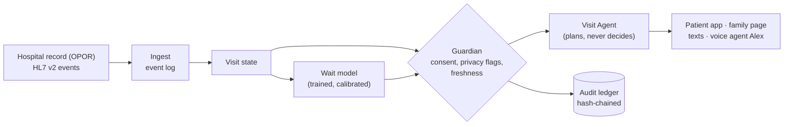

# VeriCare

**An agent for every hospital patient.** VeriCare gives each patient in hospital their own agent. It tells them and the family they choose where they are, what comes next and roughly how long it will take. It checks in while they wait, and it carries questions it must not answer to the care team. Staff type nothing extra.

This repository is our entry to the Cognizant BrAInstorm hackathon ("Agentic AI for Good"). The demo is set in an emergency department, the sharpest example of the problem. Every patient, phone number and record in it is fictional.

## The problem

In 2023-24, 52,521 Nova Scotians (10.02% of 519,310 visits) left an emergency department without being seen. The average wait from triage to a clinician was 2.96 hours (NS Department of Health and Wellness accountability report). The province's new shared record, OPOR, produces a stream of events for every visit: arrived, triaged, seen, tests ordered, results back, admitted, discharged. Today those events reach staff screens only. The patient in the waiting room and the family at home see none of it, so they phone the desk, wait without knowing why, or leave.

## What VeriCare does

Each visit gets a **Visit Agent** that wakes on that visit's own events and does three jobs:

| Job         | What the agent does                                                                                                              | Who it helps                                                        |
| ----------- | -------------------------------------------------------------------------------------------------------------------------------- | ------------------------------------------------------------------- |
| **Inform**  | Tells the patient, and the family they approve, the current step, what comes next and a personal wait range from a trained model | Patients, families, and the clerks and nurses who field their calls |
| **Protect** | Checks in while people wait ("same, better or worse?"), catches "I'm leaving", and puts the right patient in front of a nurse    | Patients and the triage nurse                                       |
| **Relay**   | Takes questions it must not answer (medication, results) to the care team with a one-line summary, and brings the answer back    | Families and nurses                                                 |

The language model plans and words things. **Code decides what may be disclosed and produces every number.** If the model is down, the same approved messages still go out through a rules planner.

## Try it

You need Node.js 24 and Docker Desktop with its Linux engine running. From the repository root:

```sh
npm ci
npm run setup          # creates .env (keeps an existing one)
npm run db:up
npm run db:migrate
npm run db:seed
npm run demo:populate
npm run demo:credentials
npm run dev            # API on 4100, web app on 3100, worker
```

To link the patient app to Maya Chen's emergency visit, set `DEMO_EMERGENCY_CONTACT_NAME`, `DEMO_EMERGENCY_CONTACT_RELATIONSHIP` and `DEMO_EMERGENCY_CONTACT_PHONE` in `.env`, then run `npm run demo:emergency` once. It records fictional contact details and sends nothing.

Then open http://127.0.0.1:3100:

| Page                    | What you see                                                                                                         |
| ----------------------- | -------------------------------------------------------------------------------------------------------------------- |
| `/professional/ed`      | The staff Desk: tasks that need a person, the board, forecasts, accuracy, the agent's decisions and the audit ledger |
| `/patient/visit`        | Maya's phone app: her step, her wait range, check-ins, "I feel worse", family sharing                                |
| `/family/<link>`        | What an approved family member sees (the link is sent by text)                                                       |
| `/professional/monitor` | Live phone calls: transcript, tool calls and texts                                                                   |
| `/pitch`                | The presentation, with a live panel that follows the current call                                                    |

**The demo control bar.** A floating bar on the staff and patient apps lets you work the department without waiting hours. Press **Start the ER demo**, then **×60** (one hour per real minute), **+5** or **Surge** to add patients, **Next step** to move a patient along, and watch the model's predicted wait change in the bar. **Reset** starts over, and the demo resets itself 30 minutes after it was last used. Details: [docs/demo/demo-bar.md](docs/demo/demo-bar.md).

Every page signs in with a fictional demo account automatically. Development servers listen on loopback only.

## How it works



- **Events in, actions out.** VeriCare reads the HL7 v2 feed a hospital interface engine already emits, in Oracle Health's formats. For the demo, an "OPOR Twin" plays a realistic department into the same listener. The visit's state is always rebuilt from its event log, so replaying the log gives the same answer.
- **The Guardian is plain code.** It checks consent, privacy markers (confidential, security alert, deceased), who is asking and how fresh the feed is, before anything is said. It checks again when a plan is applied. A silenced visit and a transfer look identical from outside.
- **The model never holds the keys.** It never sees a name, birth date, phone number, triage level, reason for visit or result. It only chooses among actions that code prepared, and text from the public is labelled as data. Words like "worse", chest pain or breathing raise a top-priority nurse task in code before any model is asked.
- **Alex, the voice agent**, answers family calls. Status and relay tools unlock only after a one-time code sent to the number the patient registered.

More: [system design](docs/design/vericare-journey-design.md), [the Visit Agent](docs/design/visit-agent.md), [OPOR interface mapping](docs/design/opor-patient-tracking.md).

## The wait model

Fifteen gradient-boosted quantile models (five steps × low, typical and high) estimate the minutes until triage, being seen, results, a decision and an inpatient bed. They use 47 inputs, all computable from the hospital feed, and are calibrated so each range should hold about 80% of the time. The API evaluates the exported trees itself, with no machine-learning runtime.

They learned from 50,258 real US emergency visits (NHAMCS), real lab turnaround times from MIMIC-IV, published Canadian figures, and a simulated department for the one thing no open dataset has: the shared queue. On simulated departments they never trained on, the 80% ranges held 78.5% to 85% of the time for every step.

**The honest caveat:** that accuracy is measured on departments from the same simulator. On the one out-of-distribution check available, the scripted demo department, the wait range held 56% to 71% of the time. Before telling real patients a number, the models must run silently against a real feed and be retrained on it. Every estimate the demo gives is logged and scored against what happened, on the staff Accuracy page.

More: [model card](ml/artifacts/MODEL_CARD.md), [how the models were built](docs/design/stage-time-model.md).

## Tests

```sh
npm test               # 219 unit tests: API, web, contracts, scripts
npm run test:backend   # database tests in isolated schemas (needs Docker and .env)
npm run check          # formatting, typecheck, unit tests and build
```

## Repository layout

| Path                            | Purpose                                                                                         |
| ------------------------------- | ----------------------------------------------------------------------------------------------- |
| `apps/web`                      | Next.js apps: staff Desk, patient app, family page, call monitor, presentation, demo bar        |
| `apps/api`                      | Fastify API and worker: authentication, workflows, voice and SMS, the trained model (`models/`) |
| `apps/api/src/journey`          | The visit pipeline: feed ingest, visit state, estimates, Guardian, messages, the demo director  |
| `apps/api/src/agents`           | The Visit Agent: planner, tools, knowledge base                                                 |
| `apps/api/src/opor`, `src/twin` | HL7 v2 parsing and mapping, and the OPOR Twin that plays a fictional department                 |
| `packages/contracts`            | Shared schemas                                                                                  |
| `ml`                            | Training pipeline, data sources and model card                                                  |
| `scripts`                       | Setup, web launcher, hosted-demo gateway                                                        |
| `docs`                          | All documentation, indexed in [docs/README.md](docs/README.md)                                  |

## Status and limits

- **Built and tested:** the feed pipeline, the Guardian, the Visit Agent with its rules fallback, the wait models, the patient app, family page, staff Desk, texts, the Alex voice agent and the demo control bar, all on fictional data.
- **Not done, and needed before real patients:** a privacy impact assessment with NS Health, Canadian hosting for speech and the language model (today OpenAI and Twilio process data outside Canada), an external security review, and a silent trial of the models against a real feed.
- **Not claimed:** there is no public OPOR API. VeriCare is built against the interfaces Oracle Health actually offers (an HL7 v2 feed and FHIR R4 for enrichment), so switching the simulator for a real feed is an integration project, not a redesign.

Security and performance summary: [docs/reports/security-scalability-summary.md](docs/reports/security-scalability-summary.md). Before changing code, read [AGENTS.md](AGENTS.md) and [CONTRIBUTING.md](CONTRIBUTING.md).

This repository has no open-source licence grant.
