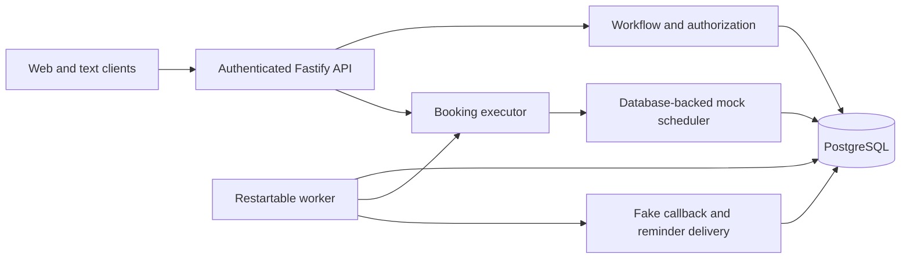

# Synthetic backend architecture

The backend implements the single fictional department's rescheduling journey. Fastify and a separate worker share PostgreSQL records and domain services. Next.js provides patient, care-team, directory and department overview workspaces. With synthetic demo mode enabled, it automatically resolves an already provisioned fictional session, stores it in a separate workspace HttpOnly cookie, and forwards allowed requests through same-origin route handlers. The demo accepts loopback access or an exact configured HTTPS `PUBLIC_DEMO_ORIGIN`; hosted Next can read the server-only `DEMO_SESSIONS_JSON` snapshot. The backend still authorizes every command and owns completion.

## Workflow

A verified synthetic identity creates a task for an accessible patient and confirms the appointment context. Department staff proposes an available slot within the recorded availability window. The proposal saves an immutable version, the current booking version, exact slot times and expiry. Staff approval schedules a callback and, if time permits, a reminder five minutes later. The assigned requester confirms the exact proposal after callback delivery and inside the agreed callback window. The worker then executes the ready task.

Task states normally advance through `awaiting_verification`, `awaiting_proposal`, `awaiting_staff_approval`, `awaiting_patient_confirmation`, `ready_to_execute`, `executing` and `completed`. Uncertain booking responses enter `reconciling`. Rejected decisions, stale slots and expired windows require a new proposal. Withdrawal or staff takeover stops pending automation.

## Authority and decisions

The separate emergency-contact phone scenario matches a patient's full name and birthday, checks the registered contact's name and relationship, and sends a one-time SMS code to the stored number. A successful spoken or keypad check permits a location lookup for that patient and call only. Both methods share expiry, single-use consumption and retry limits. It does not bind a patient/staff principal or grant appointment authority. Fictional patient-location records and salted code hashes are stored separately; SMS previews and verification arguments redact the code and reuse existing signed delivery callbacks. See [the emergency-contact demo](emergency-contact-demo.md).

Opaque bearer tokens identify an active, verified principal; only hashes are stored in the database. Local CLI provisioning supplies fictional identities. Patients access themselves. A representative needs an explicit, unexpired, unrevoked grant from the patient or department staff; emergency-contact status has no special power. Staff and operators are department-scoped. Operators monitor only. Identity and authority are rechecked by services, including before automated delivery and booking dispatch.

Commands lock the task and compare the client's expected revision. New proposals or callback windows cancel previous decisions and pending jobs. Approval and confirmation bind to the active proposal version. Completion is backend-owned: neither client payloads, an agent tool, callback delivery nor an ended call can set it.

## Persistence and recovery

Additive, ordered migrations preserve prior tasks and events. Task updates, immutable proposal versions, decisions, jobs and audit events commit transactionally. Workers lock tasks before jobs, skip work another worker has locked, and recheck eligibility before recording fake delivery. One durable receipt identifies each job; retries are bounded and visible to operators.

The executor persists a prepared operation before dispatch. Dispatch rechecks authority, approved decisions, callback evidence, expiry and exact proposed slot times. The mock scheduler atomically checks availability and booking version, changes the booking, and saves a receipt under `reschedule:<taskId>:v<version>`. Reusing a key with the same request returns the saved result; changing its request is rejected.

The committed `dispatched` status is the boundary after which a booking may already be in flight. Withdrawal/takeover arriving later records the request and enters reconciliation. Recovery first looks up that original operation key, then retries the same operation only when no result exists and current eligibility permits. Lookup failure never triggers a blind retry. Confirmed scheduler evidence remains recorded even if staff took over in flight. Successful completion preserves the approved decisions and scheduler reference.

A real child-process crash test exits after scheduler commit and recovers through a new connection pool without another booking change. This establishes recovery for the database-backed mock; external providers will need their own idempotency and reconciliation guarantees.

## Boundaries

The prototype uses one demonstration policy and stores exact UTC intervals with IANA time zones. The UI displays Halifax appointment times and labels callback inputs with the device time zone. Ordinary workflow callback/reminder delivery and scheduler changes use local mocks, independently of the optional real voice mode.

The fictional care-team directory has null phone destinations until staff saves them. Saving a destination never calls it. The separate transfer simulator requires explicit preparation and approval, then a chosen simulated outcome; connected/no-answer records are not evidence of a real handset connection. Real forwarding requires a configured destination, an authenticated phone identity and caller keypad approval after readback. The API validates signed Twilio callbacks and stream identity and records provider transfer outcomes separately from appointment completion.

For a hosted Next preview, the restricted loopback demo gateway exposes only allowed `/backend` routes and provider routes. A bearer-shaped header is a forwarding filter, not authentication: the API checks the actual session and authority. Twilio signatures are also checked by the API. Fixture and provisioning routes are excluded. The local database, API, worker, gateway and public tunnel must remain available. See [prototype demo operations](prototype-demo.md).

Real identity proof, hospital integration, production access/retention controls and durable deployment remain separate work. Real phone audio and handset transfer have not been validated. The text interpreter only extracts explicit intervals and asks for clarification otherwise.
