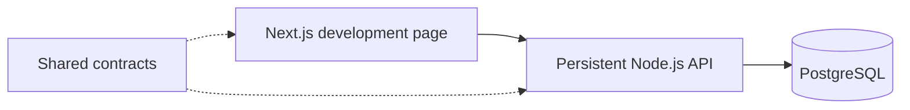

# Architecture and setup scope

The supplied team guide defines a durable appointment-rescheduling workflow. This setup establishes a single TypeScript workspace with clear component boundaries so packages can develop against agreed contracts.

The current slice is intentionally small: PostgreSQL stores synthetic T001 and its initial event; the persistent Fastify process reads it; the Next.js server renders the saved task or a truthful unavailable state. There is no workflow executor, general patient endpoint, or booking mutation yet.

Future slices add authenticated patient/staff/operator views, a backend executor, a mock scheduler, a durable delivery worker, and a text agent harness. Twilio and OpenAI Realtime are later test integrations. Complete the web journey before enabling booking through voice.

## Workflow invariants to implement

- Verify the requester and access to the specific patient/action. An emergency-contact match does not establish representative authority.
- Bind each decision to the exact proposal version. A changed proposal requires new decisions.
- Recheck authority, expiry, callback conditions, booking version and availability before execution.
- Persist an operation and its repeat-safe key before calling the scheduler. On an uncertain result, reconcile that same operation before any retry.
- Commit task changes, events and delivery work together. A worker must recheck pending work before sending.
- Staff takeover must stop new automated actions. Define how an already in-flight operation is reconciled during takeover.
- Completion requires confirmed scheduling evidence; a finished call or delivered message cannot complete a request.

The task/event schemas currently validate record shape. They do not enforce these workflow invariants. Proposal, action request, operation, outbox and authorization schemas need agreement and implementation in packages A–D/F.

## Design choices

Use npm workspaces rather than separate repositories to keep contracts and review changes together. Keep a persistent backend process separate from Next.js so later job execution is not tied to a web request lifetime. Use PostgreSQL for durable state and transactions. The foundation payload column avoids pretending a complete domain schema is settled; normalize versioned proposals, operations and delivery records in reviewed migrations.

No existing NS-Dispatcher code, deployment or data is imported. This project has a distinct appointment-rescheduling scope. No paid service, deployment, collaborator access or live integration is configured by this repository setup.
