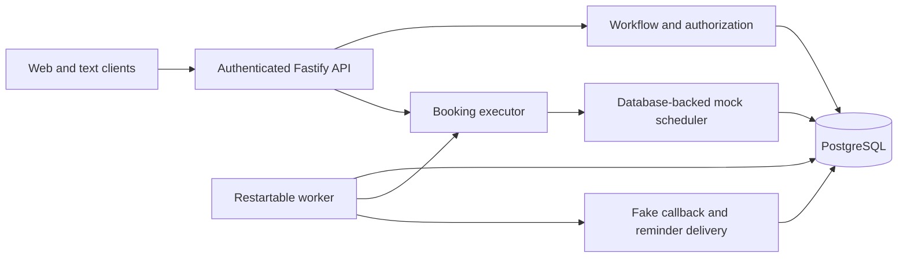

# Synthetic backend architecture

The backend implements the single fictional department's rescheduling journey. Fastify and a separate worker share PostgreSQL records and domain services. Next.js currently renders the development fixture; patient, staff and operator APIs are ready for a fuller frontend.

## Workflow

A verified synthetic identity creates a task for an accessible patient and confirms the appointment context. Department staff proposes an available slot within the recorded availability window. The proposal saves an immutable version, the current booking version, exact slot times and expiry. Staff approval schedules a callback and, if time permits, a reminder five minutes later. The assigned requester confirms the exact proposal after callback delivery and inside the agreed callback window. The worker then executes the ready task.

Task states normally advance through `awaiting_verification`, `awaiting_proposal`, `awaiting_staff_approval`, `awaiting_patient_confirmation`, `ready_to_execute`, `executing` and `completed`. Uncertain booking responses enter `reconciling`. Rejected decisions, stale slots and expired windows require a new proposal. Withdrawal or staff takeover stops pending automation.

## Authority and decisions

Opaque bearer tokens identify an active, verified principal; only hashes are stored in the database. Local CLI provisioning supplies fictional identities. Patients access themselves. A representative needs an explicit, unexpired, unrevoked grant from the patient or department staff; emergency-contact status has no special power. Staff and operators are department-scoped. Operators monitor only. Identity and authority are rechecked by services, including before automated delivery and booking dispatch.

Commands lock the task and compare the client's expected revision. New proposals or callback windows cancel previous decisions and pending jobs. Approval and confirmation bind to the active proposal version. Completion is backend-owned: neither client payloads, an agent tool, callback delivery nor an ended call can set it.

## Persistence and recovery

Additive, ordered migrations preserve prior tasks and events. Task updates, immutable proposal versions, decisions, jobs and audit events commit transactionally. Workers lock tasks before jobs, skip work another worker has locked, and recheck eligibility before recording fake delivery. One durable receipt identifies each job; retries are bounded and visible to operators.

The executor persists a prepared operation before dispatch. Dispatch rechecks authority, approved decisions, callback evidence, expiry and exact proposed slot times. The mock scheduler atomically checks availability and booking version, changes the booking, and saves a receipt under `reschedule:<taskId>:v<version>`. Reusing a key with the same request returns the saved result; changing its request is rejected.

The committed `dispatched` status is the boundary after which a booking may already be in flight. Withdrawal/takeover arriving later records the request and enters reconciliation. Recovery first looks up that original operation key, then retries the same operation only when no result exists and current eligibility permits. Lookup failure never triggers a blind retry. Confirmed scheduler evidence remains recorded even if staff took over in flight. Successful completion preserves the approved decisions and scheduler reference.

A real child-process crash test exits after scheduler commit and recovers through a new connection pool without another booking change. This establishes recovery for the database-backed mock; external providers will need their own idempotency and reconciliation guarantees.

## Boundaries

The prototype uses one configured demonstration policy and explicit UTC intervals with IANA time zones. It has no external calls, real identity proof, hospital connector, hosted access controls or retention policy. The text interpreter only extracts explicit intervals and asks for clarification otherwise. A production packaging and deployment design remains separate work.
