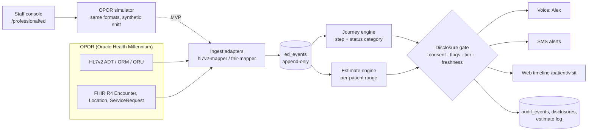

# VeriCare Journey: per-patient ED tracking on OPOR

> The master design is now [vericare-journey-design.md](vericare-journey-design.md) (agents, ML, twin, demo). This document remains the reference for the OPOR interface mapping; where the two differ, the master design wins.

Draft design, 2026-11-11, for the Cognizant BrAInstorm MVP. Built from public sources only; internal NS Health / OPOR Hub material was not used. Sources and the full research set are in [research/](../research/README.md).

## The feature in one line

OPOR puts every emergency visit in Nova Scotia on one Oracle Health record from 2026-11-14. VeriCare Journey turns that visit's events into a personal answer to "where am I, what's next, and roughly how long?" for the patient, and for the family members they approve, by phone, text or web.

Today YourHealthNS predicts waits per facility, for less-urgent patients, updated hourly. Nobody tells an individual patient their own step or their own range. That is the gap.

## What OPOR gives us (and what it doesn't)

| Fact                                                                                                                          | Status                                                               | Source                                                                         |
| ----------------------------------------------------------------------------------------------------------------------------- | -------------------------------------------------------------------- | ------------------------------------------------------------------------------ |
| QEII went live on OPOR 2026-05-09; Northern, Eastern and Western zones 2026-11-14                                             | Confirmed                                                            | news.novascotia.ca 2026-05-07; physicians.nshealth.ca OPOR implementation page |
| OPOR supports ED patient flow; glossary lists an ED electronic whiteboard                                                     | Confirmed (glossary via search summary)                              | opor.nshealth.ca                                                               |
| QEII Care Coordination Centre (C3, GE HealthCare) ingests real-time Cerner Millennium messages and has an "ED Expediter" tile | Confirmed (2023 article); C3 consuming OPOR is likely, not confirmed | nshealth.ca/care-coordination-centre-c3; canhealth.com 2023-03-03              |
| Public OPOR API, FHIR endpoint, sandbox or marketplace                                                                        | Not found                                                            | —                                                                              |
| Family-facing status, caregiver/proxy access, notifications                                                                   | Not in any public plan                                               | —                                                                              |
| Oracle Health Millennium FHIR R4 open sandbox                                                                                 | Works today (tested 2026-11-11, returns Encounters)                  | `https://fhir-open.cerner.com/r4/ec2458f2-1e24-41c8-b71b-0e701af7583d`         |

Implication for the pitch: we don't claim an OPOR API exists. We build against the two interfaces Oracle Health actually offers, in Oracle's own formats, and name the pathway to switch the simulator for the real feed (NS Health integration engine or C3, via the Innovation Hub).

### Two ways in, in order of preference

1. **HL7 v2 event feed (ADT/ORM/ORU)** from the NS Health integration engine. This is how real-time ED tools such as Vocera/Stryker connect to Cerner sites (a real-time ADT listener, default port 2575). It's the only practical source of granular, push-based ED events.
2. **Millennium FHIR R4, for enrichment only.** FHIR can't discover new ED events: the sandbox rejects `Encounter?_lastUpdated=…` without a patient, id, identifier or account, and there is no Subscription, Flag or `$export` on the open endpoint. Once HL7 v2 tells us about an encounter, FHIR reads it by id with system (backend) authorization. `Encounter.status` is only `planned | in-progress | finished | cancelled`, so ED sub-states come from `location[]`, `participant[]`, ServiceRequest and DiagnosticReport status. `Encounter.priority` is admission type, not CTAS.

The closest public precedent is Vital Emergency's Cerner requirements: filter the ADT feed on the ED location (PV1-3/6), take A04/A08/A02/A03, and read PID-29/30 for deceased; some sites add a room/bed extract. See [research/01](../research/01-oracle-health-interfaces.md) for annotated sample messages.

## Architecture

Code, not the model, owns every arrow into the gate. The voice model only gets back an approved sentence and a range string.

### Internal event model

Every source is normalized to one `EdEvent`, so the hospital-specific uncertainty lives in a per-site mapper:

`arrived · triaged(ctas) · provider_assigned · location_changed · order_placed · result_available · consult_requested · admit_decision · bed_requested · moved_to_unit · discharged · cancelled · flag_set · flag_cleared`

### Mapping to Oracle Health

| Journey status            | FHIR R4 (Millennium)                                                              | HL7 v2                                                       | Confidence                   |
| ------------------------- | --------------------------------------------------------------------------------- | ------------------------------------------------------------ | ---------------------------- |
| Arrived                   | Encounter `in-progress`, `period.start`, ED location                              | A04, PV1-2 = E                                               | Likely                       |
| Triaged (CTAS)            | No standard field; `Encounter.priority` is admission type                         | A08 with a site-specific Z-segment or tracking-board extract | Site-specific mapper setting |
| Waiting to be seen        | ED waiting/triage location, no ATND participant                                   | A08 / A02                                                    | Derived                      |
| Being seen                | `participant[]` type ATND added, exam-room location                               | A08 (PV1-7) / A02                                            | Derived                      |
| Tests in progress         | ServiceRequest `active`, DiagnosticReport not `final` (status only, never values) | ORM^O01 / ORU^R01                                            | Resources confirmed          |
| Admitted, waiting for bed | `class` → IMP while location still ED                                             | A01 / A06 with PV1-3 = ED                                    | Derived                      |
| Moved to a unit           | new `location[]` entry, ED location `completed`                                   | A02                                                          | Derived                      |
| Discharged                | Encounter `finished`, `period.end`                                                | A03                                                          | Likely                       |

### Sensitivity: fail closed

Confidential/VIP and security alerts aren't documented in Millennium FHIR; restricted patients are probably filtered out rather than labelled. So the gate treats any of these as "hand off, say nothing": `deceased[x]` present, any security label, PV1-16 VIP set or `hospitalization.specialCourtesy` valued, a security/violence alert, CTAS 1–2, an empty or filtered result, an unmapped state, or a feed older than 15 minutes. The existing `location_shareable=false` in `emergency_patient_records` becomes the confidential flag.

## Individual estimates

This deliberately changes the VeriCare document's "never wait-time estimates" rule, with these limits:

- **An 80% range, led by its upper bound, never a promise.** "You'll likely be seen within 3 hours, possibly sooner. Sicker patients are seen first, so this can change. If you feel worse, tell the triage nurse right away or call 911."
- **Only for the next step**: time to first assessment while waiting, typical result turnaround while tests are pending (lab vs imaging). No estimate for admitted-waiting-for-bed (boarding is too unpredictable).
- **Suppressed** for CTAS 1–2, any flag, stale feed, or too little data. Family hears it only if the patient's consent includes the `estimates` scope; PHIA s.37 covers general condition, so a personal range needs that express consent.
- **Calculated by code** and spoken from a fixed template. The model can't change the numbers.
- **Logged against the actual wait**, so we can report how often the real wait fell inside the range (coverage) and how often it was longer.

**MVP method (works with synthetic data in 4 days):** for patient _p_ with CTAS _k_, point wait = (patients ahead with same or more urgent CTAS + 1) ÷ (assessments per hour − recent more-urgent arrivals per hour). Scale it to an 80% interval with conformal multipliers per CTAS stratum, calibrated on each patient's _actual remaining_ wait in a replayed synthetic month (ERstat calibrated on published waits and covered only ~22% of real visits). Recompute on every event; text only when the upper bound moves past a hysteresis threshold, and send an "it's taking longer than expected" update when a patient passes their upper bound. Full algorithm in [research/03](../research/03-wait-estimates.md); simulator parameters (Ontario CIHI PIA mean 118 min, p90 257 min; NHAMCS; Rapid Assessment Zone) in [research/02](../research/02-ed-operations-and-data.md).

**Pilot method:** quantile regression forests on OPOR history (calendar, census, staffing, acuity). Arora, Taylor & Mak (MSOM 2023) show they beat rolling averages for individual ED waits; Pak et al. (2021) cut large under-predictions by 42% with quantile regression. These are the same inputs NS Health's facility tool already uses, applied per patient.

### Left-without-being-seen

10.02% of NS ED patients left without being seen in 2023-24. Patients can text **LEAVING** (or say it on a call). VeriCare replies with their current step and range, and alerts the triage nurse so someone can reassess before they go. That gives the pilot a hard outcome to measure.

Be honest about evidence: two RCTs found estimates don't change satisfaction, and no controlled trial shows texting reduces LWBS. The pitch rests on staff interruptions avoided, family calls answered without a nurse, and the LEAVING-to-nurse loop; estimates are orientation and respect, measured in the pilot.

## How it fits careBridge

| Already built                                              | Reused for                                                                                               |
| ---------------------------------------------------------- | -------------------------------------------------------------------------------------------------------- |
| `emergency-lookup.ts`, migration 011                       | Patient match by name + birthday, registered-contact check, SMS one-time code with expiry and 5 attempts |
| `voice-agent.ts`, `realtime-bridge.ts`, `voice-persona.ts` | Alex reads journey status and estimate; AI disclosure; handoff wording                                   |
| `twilio-sms.ts`, `voice-sms.ts`                            | Proactive alerts and LEAVING replies                                                                     |
| `worker.ts`                                                | Durable jobs: recompute estimates, send alerts, staleness checks                                         |
| `/professional/monitor`                                    | Call transcripts and tool events (starting point for the audit viewer)                                   |
| `/patient`, `/professional`, `/desktop`                    | Patient timeline, staff console, ED overview                                                             |

| To add                                                  | Notes                                                                                                                                                                                  |
| ------------------------------------------------------- | -------------------------------------------------------------------------------------------------------------------------------------------------------------------------------------- |
| Migration 012                                           | `ed_encounters`, `ed_events` (append-only, raw source kept), `sensitivity_flags`, `consent_records` (scopes: status, alerts, estimates), `disclosures`, `estimate_log`, `audit_events` |
| `apps/api/src/opor/`                                    | `hl7v2-mapper.ts`, `fhir-mapper.ts` (tested against the Oracle open sandbox), `simulator.ts` (replays a synthetic shift in both formats)                                               |
| `ed-journey.ts`, `ed-estimate.ts`, `disclosure-gate.ts` | Pure functions with gate tests first                                                                                                                                                   |
| Agent tools                                             | `get_journey_status`, `get_estimate`: return an approved sentence + range text only, after the gate                                                                                    |
| Web                                                     | `/patient/visit` timeline with range; `/professional/ed` to advance events, set flags and see predictions vs actuals                                                                   |

## Build order to 2026-11-15

The challenge page lists MVP semi-finals on Nov 18; confirm whether Nov 15 is the submission cut-off. Security and code fixes from research ([05](../research/05-security-threat-model.md), [08](../research/08-codebase-and-stack.md)) go into step 1: OTP failures counted per patient + contact, demo code blocked outside synthetic mode, tool gating enforced server-side, signed inbound SMS route, hash-chained append-only audit.

1. **Nov 11–12:** migration 012, `EdEvent`, journey engine, disclosure gate, gate tests (unknown patient, wrong code, flagged, stale, CTAS 1–2, prompt injection).
2. **Nov 12:** simulator with HL7v2 + FHIR output; FHIR mapper verified against the open sandbox.
3. **Nov 13:** estimate engine on a replayed synthetic month; estimate log and coverage.
4. **Nov 13–14:** agent tools in Alex, SMS alerts, LEAVING flow, `/patient/visit` and `/professional/ed`.
5. **Nov 14–15:** record the demo calls and the 3-minute video.

### Demo script

1. Patient arrives (simulator sends A04), is triaged CTAS 4, and gets a text: step 2 of 5, likely seen within 3 hours.
2. Staff console: three CTAS 2 arrivals. The range moves and the patient gets an updated text.
3. Verified daughter calls Alex and hears status plus the range. An impostor with the right details but no code gets the neutral reply.
4. Patient texts LEAVING; the triage nurse is alerted on the console.
5. Staff set a confidential flag; the next call is handed off with the same wording as any transfer, and no estimate is sent.

## Expected objections

| Objection                                                   | Answer                                                                                                                                                                                                                                      |
| ----------------------------------------------------------- | ------------------------------------------------------------------------------------------------------------------------------------------------------------------------------------------------------------------------------------------- |
| There's no OPOR API                                         | Correct. We built on Oracle Health's own HL7v2 and FHIR formats, tested against Oracle's sandbox. Going live is an interface agreement with NS Health (integration engine or C3), not a rewrite.                                            |
| Estimates will be wrong and people will leave or delay care | Ranges, not promises; suppressed for urgent patients; escalation line on every message; coverage measured; LEAVING alerts a nurse.                                                                                                          |
| An AI disclosing health information by phone                | Code decides disclosure; only approved general categories that PHIA s.37 already allows on request; opt-in consent; append-only audit; same handoff wording for every transfer.                                                             |
| Health information leaves Canada                            | Yes, today: OpenAI Realtime runs in the US/EU and Twilio has no Canadian region, while PIIDPA s.5 requires Canadian storage and access. MVP is synthetic only; a pilot needs Canadian-hosted speech and telephony or an approved exception. |
| ED evidence is thin                                         | Agreed: the strongest data is surgical (CHUM: 98% of caregivers worried less). The pilot plan measures baseline calls, LWBS and coverage first.                                                                                             |

## Open questions to verify

- Which event feed NS Health would expose (integration engine vs C3), and whether CTAS and tracking-board locations are in it.
- How OPOR marks confidential patients, VIPs and security alerts.
- Whether Millennium emits `class = EMER` for ED visits.
- Data residency for OPOR's Oracle Cloud hosting and for the voice provider.
- Current stage of federal Bill S-5 (Connected Care for Canadians Act).
