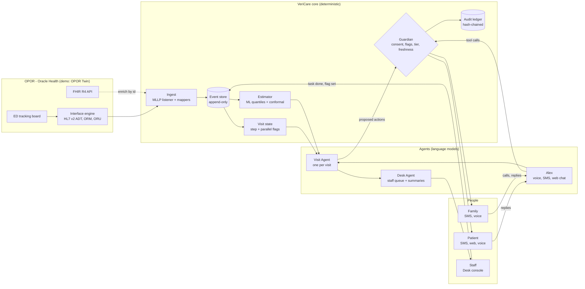
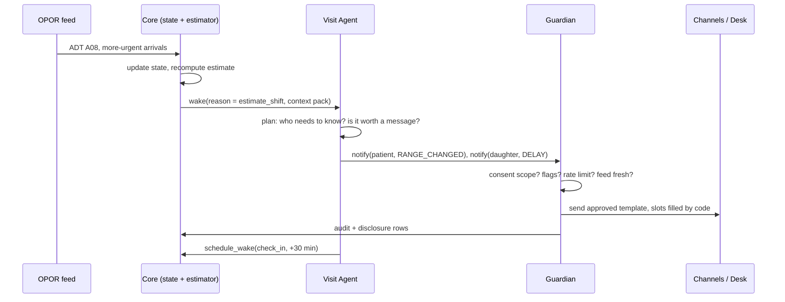
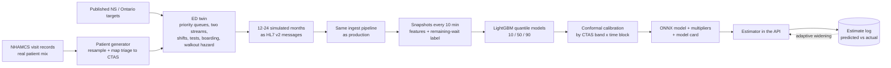

# VeriCare Journey: system design

Proposed design, 2026-11-11. Nothing in this document is built yet unless the "Reuse" column says so. It is the master design for the Cognizant BrAInstorm entry ("Agentic AI for Good"). It is a demo: every patient is synthetic, OPOR is simulated in Oracle Health's real formats, and any component may be swapped for a stand-in that shows the same idea. Evidence and sources are in [research/](research/README.md); the OPOR interface detail is in [opor-patient-tracking.md](opor-patient-tracking.md).

## 1. The idea

**Every emergency visit gets its own agent.**

From 2026-11-14 every emergency department in Nova Scotia records visits in one system, OPOR. Each visit becomes a stream of events: arrived, triaged, seen, tests ordered, results back, admitted, discharged. Today that stream feeds staff screens only. The patient in the waiting room and the family at home see none of it.

VeriCare Journey attaches a **Visit Agent** to each visit. It watches that visit's events and does three jobs:

| Loop        | What the agent does                                                                                                                               | Who benefits                                           | What we measure                                        |
| ----------- | ------------------------------------------------------------------------------------------------------------------------------------------------- | ------------------------------------------------------ | ------------------------------------------------------ |
| **Inform**  | Tells the patient, and the family they approve, where they are in the visit, what comes next, and a personal wait range from an ML model          | Patient, family, the clerks and nurses who field calls | Family calls answered without staff; estimate coverage |
| **Protect** | Checks in while people wait ("same, better or worse?"), catches "I'm leaving", and puts the right patient in front of a nurse                     | Patient, triage nurse                                  | Time to recheck after "worse"; walkouts intercepted    |
| **Relay**   | Takes questions it must not answer (medication, results, anything sensitive) to the care team with a one-line summary, and brings the answer back | Family, nurse                                          | Questions routed; interruptions avoided                |

The model converses, plans and summarises. Code decides what may be disclosed. A learned model, not the language model, produces every number.

### Why this, why now

- 52,521 Nova Scotians (10.02% of 519,310 visits) left an emergency department without being seen in 2023-24; the average wait from triage to a clinician was 2.96 hours. (NS DHW accountability report, confirmed in [research/02](research/02-ed-operations-and-data.md).)
- Nova Scotia already answered the waiting-room risk with people: Waiting Room Care Providers who recheck patients, and Patient Advocates. VeriCare gives those people a queue of who needs them next. (Roles confirmed in research/02.)
- Two widely reported deaths in late December 2022 followed long emergency waits, one after the patient left without being seen, and preceded the province's January 2023 emergency-care actions. _(From general knowledge, not the research set: verify wording and dates before using in the pitch.)_
- YourHealthNS shows a facility-wide predicted wait. No public plan gives an individual their own step, their own range, or a family channel.
- Honest evidence: trials show wait estimates alone don't raise satisfaction, and no controlled trial shows texting cuts walkouts. So the estimate is one tool inside the agent, and the pitch rests on the Protect and Relay loops plus calls deflected.

## 2. Design principles

1. **Events in, actions out.** The agent wakes on OPOR events, timers and inbound messages. It never polls a person for data entry, and staff type nothing extra.
2. **The language model adds helpfulness, never authority.** Disclosure, numbers and escalation floors are code. If the model is down, templates still go out and the system stays safe.
3. **Every feature must be computable from the OPOR feed alone.** No staffing rosters, no manual inputs. This keeps the path from demo to pilot short.
4. **Fail closed, and look the same when you do.** Any doubt means a handoff with identical wording, so silence and transfers reveal nothing.
5. **Show your accuracy.** Every estimate is logged against what happened and the coverage is on the staff console. No competitor publishes this.
6. **Restraint is a decision.** "Do nothing" is a logged agent action. Fewer, better messages.

## 3. People and experiences

### Patient (waiting room, any phone)

1. At registration the phone number is already in OPOR. The patient gets one text: reply YES for updates. No app, no login.
2. A link opens their visit page: current step, what's next, and "likely seen within about 3 hours, possibly sooner".
3. They add a family member by number. That person confirms by text.
4. While they wait, the agent checks in at intervals tied to triage level: "Are you feeling the same, better or worse?" _Worse_ raises a recheck for the nurse at once.
5. If the range moves, they hear why: "Several very sick patients arrived, so the wait is longer."
6. They can text or say anything: STATUS, LEAVING, "where can I charge my phone", "I need an interpreter".

### Family (at home, any phone)

1. Texts arrive on step changes. Third person, steps only, no severity words.
2. They can call. Alex (the voice agent) says it is an AI, verifies them with a one-time code to the number the patient registered, then reads the status and range.
3. A clinical question ("can she take her pills?") is relayed to the nurse; a text comes back when it is picked up.
4. A sensitive record, an unverified caller and a patient who is not there all get the same calm reply.

### Staff (triage nurse, Waiting Room Care Provider, charge nurse)

1. One screen, the **Desk**: a short ranked queue. "Recheck: bed-less patient in waiting room reports feeling worse, dizzy, 2 h 10 since triage." "Leaving: CTAS 3, waited 3 h." "Question from daughter: evening medication."
2. One tap closes a task or sends a standard reply.
3. A "likely to leave" list from the leave-risk model, for the Patient Advocate.
4. Everything the agent told anyone is visible, with a kill switch per patient and for the department.

## 4. System architecture



| Layer       | Responsibility                                                        | Demo implementation                                                                | Real product                                                                 |
| ----------- | --------------------------------------------------------------------- | ---------------------------------------------------------------------------------- | ---------------------------------------------------------------------------- |
| OPOR        | Source of truth for the visit                                         | **OPOR Twin**: simulated ED emitting real-format HL7 v2 over MLLP and serving FHIR | NS Health integration engine feed, or the QEII Care Coordination Centre feed |
| Ingest      | Parse, de-duplicate, map site codes to `EdEvent`                      | `@medplum/hl7` parser, per-site mapper config                                      | Same code, new mapper config                                                 |
| Event store | Append-only log, raw message kept                                     | PostgreSQL                                                                         | Same                                                                         |
| Visit state | Current step plus parallel flags, derived only from events            | Pure function, replayable                                                          | Same                                                                         |
| Estimator   | Personal wait range and stage durations                               | LightGBM quantile models trained on open data + twin                               | Retrained on OPOR history                                                    |
| Guardian    | Consent, sensitivity, tier, freshness, rate limits, tool unlock order | Pure function with gate tests                                                      | Same, policy set by the department                                           |
| Agents      | Converse, plan, summarise                                             | Existing OpenAI live voice + a text model                                          | Vendor chosen for Canadian hosting                                           |
| Channels    | Voice, SMS, mobile web                                                | Twilio + Next.js (already in repo)                                                 | Same pattern, approved vendors                                               |
| Desk        | Staff queue, flags, accuracy ledger                                   | Next.js page                                                                       | Could embed in existing staff tools                                          |

### The visit as a state, not a line

Tests start in the waiting room before a doctor sees the patient, so a strict five-step line is wrong. State is one **primary step** plus **parallel flags**:

- Primary: `arrived → triaged → waiting → being_seen → deciding → (going_home | admitted_waiting_bed → moved_to_unit) → ended`
- Flags: `tests_in_progress`, `results_ready_for_review`, `consult_requested`, `bed_requested`
- Stream: `main` or `rapid_assessment` (the Halifax Infirmary's Rapid Assessment Zone takes up to 30% of patients; it is a separate queue for estimates)

Patients see five friendly steps (Checked in, Waiting to be seen, Being seen, Tests and results, Next steps) with flags shown as badges.

## 5. The agents

Three agents, one guardian, one estimator. Only the agents use language models.

| Component       | Kind                                         | Wakes on                                                                                                 | Can do                                                                                                                                                                                         | Cannot do                                                      |
| --------------- | -------------------------------------------- | -------------------------------------------------------------------------------------------------------- | ---------------------------------------------------------------------------------------------------------------------------------------------------------------------------------------------- | -------------------------------------------------------------- |
| **Visit Agent** | Text model, one logical instance per visit   | Step change; estimate change past threshold; inbound message; timer (check-in due, overrun); staff reply | Choose which approved message to send, to whom, on which channel and language; ask a check-in; open a staff task; answer from the knowledge base; schedule its next wake; decide to do nothing | Compose facts or numbers; read the record; bypass the Guardian |
| **Alex**        | Realtime voice model (also SMS and web chat) | A call or message                                                                                        | Hold the conversation, verify identity through tools, read back approved sentences, relay questions, warm-transfer                                                                             | Disclose anything a tool did not return                        |
| **Desk Agent**  | Text model                                   | A new staff task or a change in priority                                                                 | Summarise in one line, merge duplicates, rank the queue, draft the standard reply                                                                                                              | Close a clinical task; change a flag                           |
| **Guardian**    | Code                                         | Every proposed action and tool call                                                                      | Allow, rewrite to handoff, or deny; write the audit row                                                                                                                                        | Be overridden by any prompt                                    |
| **Estimator**   | ML model                                     | Every relevant event and a 10-minute timer                                                               | Produce quantiles, reason codes, or abstain                                                                                                                                                    | Speak to anyone directly                                       |

### Visit Agent loop



**Context pack.** Built by code after the Guardian's filter: allowed facts per audience, messages already sent, consent scopes, language, open staff tasks, and the list of actions permitted right now. The model never sees the diagnosis, the reason for visit, results, or anything from a flagged record.

**Tools.**

| Tool                                       | Effect                                                                             | Guardrail                                                               |
| ------------------------------------------ | ---------------------------------------------------------------------------------- | ----------------------------------------------------------------------- |
| `notify(audience, message_type)`           | Sends a catalogued message; code fills status, range and names                     | Message type must be allowed for that audience's tier and scopes        |
| `ask_check_in(question_id)`                | "Same, better or worse?" and similar                                               | Interval floor by triage level; patient only                            |
| `open_staff_task(kind, priority, summary)` | Adds to the Desk queue: `recheck`, `leaving`, `question`, `interpreter`, `comfort` | Summary is checked for banned content; priority has a floor set by code |
| `answer_from_kb(article_id)`               | Non-clinical answers: parking, visiting, what triage levels mean, phone charging   | Curated articles only                                                   |
| `handoff(target)`                          | Warm transfer or "please speak with the ER team"                                   | Always allowed                                                          |
| `schedule_wake(at, reason)`                | Sets the next timer                                                                | Bounded                                                                 |
| `do_nothing(reason)`                       | Logged restraint                                                                   | None                                                                    |

**Floors the model cannot lower** (code, checked before and after the model runs):

- "Worse", chest pain, trouble breathing, fainting, bleeding or self-harm words in any inbound message always open a `recheck` task at top priority and send the "tell the triage nurse now or call 911" line.
- LEAVING always opens a `leaving` task and replies with the current step.
- Any sensitivity flag silences the visit: queued messages are cancelled, every contact gets the standard handoff.
- No more than one proactive range text per 30 minutes, six per visit.

**Fallback.** If the model is unavailable or its plan fails validation, a rules path sends the template for the step change. The agent is an upgrade, not a dependency.

### Alex: tool unlock order

| Step | Tool                 | Unlocks when                        | On failure                                            |
| ---- | -------------------- | ----------------------------------- | ----------------------------------------------------- |
| 1    | `lookup_patient`     | Caller gives name and date of birth | Neutral reply; no confirmation the patient exists     |
| 2    | `check_sensitivity`  | Patient found (silent)              | Only `handoff` stays unlocked                         |
| 3    | `check_consent`      | Flags clear                         | Route to staff                                        |
| 4    | `send_code`          | Consent exists for this contact     | Lock and route to staff                               |
| 5    | `verify_code`        | Code sent to the number on file     | Lockout after failures, counted per patient + contact |
| 6    | `get_journey_status` | Verified; flags rechecked           | Offer a callback                                      |
| 7    | `get_estimate`       | Verified and `estimates` scope      | Status only                                           |
| 8    | `relay_question`     | Verified                            | Offer the ER desk number                              |
| any  | `handoff`            | Always                              | Falls back to the charge nurse line                   |

The server enforces this order per call. Steps 1 to 5 exist in the repo today (`emergency-lookup.ts`, 21 tests).

### Disclosure tiers

| Tier | Who                                       | Hears                                                |
| ---- | ----------------------------------------- | ---------------------------------------------------- |
| 0    | Unverified, no consent, or flagged record | Nothing; neutral reply or handoff                    |
| 1    | Details match, code pending               | That verification can be completed                   |
| 2    | Verified contact, `status` scope          | Step in general terms                                |
| 2+   | Verified contact, `estimates` scope       | Step and range                                       |
| 3    | The patient                               | Full timeline, range, reasons for changes, check-ins |

## 6. OPOR integration and the OPOR Twin

**Real interface, confirmed by research:** HL7 v2 ADT is the event source (A04 arrival, A08 update, A02 move, A03 discharge, A01/A06 admit, A11/A13 cancels, ORM/ORU for order and result _status_ only). FHIR R4 is enrichment by id, because Oracle's API rejects "what changed since" queries. Triage level and confidentiality flags have no standard field, so they are mapper settings per site. Annotated sample messages: [research/01](research/01-oracle-health-interfaces.md).

**The OPOR Twin** is a separate process (`apps/twin`) that stands in for OPOR across a real network boundary:

- A discrete-event simulation of a Halifax-Infirmary-sized department (about 200 visits a day, a figure from one academic paper that the per-site report charts could not confirm; main and rapid-assessment streams, shift-based capacity, waiting-room bloodwork, boarding).
- Emits HL7 v2.5.1 messages over MLLP to VeriCare's listener, exactly as an interface engine would, and serves the same visits as FHIR R4 Encounters.
- Renders a tracking board that mirrors the statuses Oracle's ED module shows staff (triage complete, needs provider, evaluation in progress, orders complete, bed request), so judges see "OPOR" on one side and VeriCare reacting on the other.
- A **scenario director** scripts the demo (arrival, surge, flag) on an accelerated clock: three hours of visit in about three minutes. The codebase already injects `now()` everywhere, so time can be driven.
- Optional realism: track the Halifax Infirmary wait that NS Health publishes hourly and scale the twin's load to it, so the twin follows a real day. _(Check the site's terms before automating.)_

**Contract tests against real Oracle data.** The FHIR mapper runs against Oracle Health's public sandbox (`fhir-open.cerner.com`, verified reachable 2026-11-11) so the claim "this parses real Oracle output" is true on stage.

**Fail closed.** Deceased indicator, VIP or confidential marker, security alert, triage level 1 or 2, an empty or filtered record, an unmapped code, or a feed older than 15 minutes: the visit goes silent and contacts get the standard handoff.

## 7. Machine learning

One principle: **train on real open patient data, learn queue dynamics from a calibrated twin, prove calibration, and retrain on OPOR history in the pilot.** No public dataset contains both per-patient waits and the live queue state of a Canadian ED, so the design combines sources that each supply one part.

### Data

| Source                                                                | Real patients?     | Access                                                                            | Supplies                                                                                                                                                                | Limit                                                                                      |
| --------------------------------------------------------------------- | ------------------ | --------------------------------------------------------------------------------- | ----------------------------------------------------------------------------------------------------------------------------------------------------------------------- | ------------------------------------------------------------------------------------------ |
| **NHAMCS ED public-use files** (US CDC)                               | Yes, de-identified | Open download                                                                     | Who arrives: age, arrival mode, triage level, arrival time, tests ordered, wait to provider, length of visit, admission, boarding, left-without-being-seen dispositions | US waits are much shorter; no live queue state. _(Confirm exact variable names per year.)_ |
| **NS DHW report, NS Health wait page, CIHI, Ontario Auditor General** | Aggregates         | Public                                                                            | Calibration targets: 2.96 h mean wait, 10.02% walkouts, 65/35 acuity mix, Ontario 118 min mean / 257 min p90, 13 h mean bed wait                                        | Averages only                                                                              |
| **Yale triage dataset** (Hong et al. 2018, about 560k visits)         | Yes, de-identified | Public release _(check licence)_                                                  | Admission outcome with rich triage features                                                                                                                             | No timestamps                                                                              |
| **4TU "Sepsis Cases" hospital event log**                             | Yes, de-identified | Public _(check licence)_                                                          | Real timestamped ER registration, triage, lab and admission events for testing journey derivation                                                                       | About 1,000 cases, one Dutch hospital                                                      |
| **MIMIC-IV-ED**                                                       | Yes                | Full set needs credentialing; an open demo subset is believed to exist _(verify)_ | Schema tests now; richer training later                                                                                                                                 | No "seen by provider" time; cannot be redistributed                                        |
| **Synthea**                                                           | No                 | Open                                                                              | Names and identities for demo patients                                                                                                                                  | No ED timing                                                                               |
| **Oracle public FHIR sandbox**                                        | No                 | Open                                                                              | Mapper contract tests                                                                                                                                                   | Read-only test data                                                                        |

### Models

| #      | Model                           | Predicts                                                                          | Trained on                                                              | Used for                                                          | Shown to people?       |
| ------ | ------------------------------- | --------------------------------------------------------------------------------- | ----------------------------------------------------------------------- | ----------------------------------------------------------------- | ---------------------- |
| **M1** | **Wait-to-provider** (headline) | 10th, 50th, 90th percentile of remaining minutes until first provider assessment  | Twin event logs populated with NHAMCS patients                          | The personal range                                                | Yes, as a range        |
| M2     | Stage durations                 | Quantiles for results turnaround by test type and load; provider-seen to decision | Twin logs calibrated to published turnaround studies                    | "Results often take about 1 to 2 hours"                           | Yes, as typical ranges |
| M3     | Admission likelihood            | P(admitted) at triage                                                             | Yale and/or NHAMCS (real outcomes)                                      | Internal only: prepare next-step wording, never estimate boarding | **Never**              |
| M4     | **Leave risk**                  | P(leaves before being seen) now, rising with elapsed wait                         | NHAMCS left-without-being-seen labels for _who_; twin hazard for _when_ | Timing of check-ins; the Desk "likely to leave" list              | Staff only             |
| M5     | Message understanding           | Intent, urgency, language of an inbound message                                   | No training: language model with a strict schema plus keyword floors    | Routing                                                           | No                     |

### M1 training pipeline



Why generate training data through the real ingest path: the model trains on exactly the features production computes, so there is no gap between training and serving.

**Features (all derivable from the HL7 feed):**

- _Patient:_ triage level, age band, arrival mode, stream, minutes since triage, tests already ordered.
- _Queue:_ patients ahead by triage band, same-level ahead, total waiting, in treatment, boarding, results pending.
- _Flow:_ assessments started in the last 30/60/180 min per stream, arrivals in the last 60 min by band, rolling median of recent realised waits, the fluid estimate `(ahead + 1) / (pace − more-urgent arrival rate)`.
- _Capacity proxy:_ distinct providers who picked up a patient in the last 60 min (read from the attending field; no roster needed).
- _Calendar:_ hour, weekday, holiday.

**Label:** remaining minutes to first provider, with walkouts kept as censored cases (dropping them would hide the longest waits).

**Calibration of the twin:** tune a handful of capacity parameters until its outputs match the published targets. Then **randomise** arrival intensity, capacity and acuity mix across training runs so the model learns the relationship between queue and wait, not one department's habits. Test on a held-out configuration (a Dartmouth-General-sized site) and on a surge.

**Calibrated ranges:** conformalized quantile regression gives an 80% interval per stratum (triage band × time of day), measured against each patient's _actual remaining wait_. Adaptive conformal inference widens the range automatically after consecutive misses.

**Evaluation and targets:**

| Metric                                                | Target                                                               | Baselines to beat                                                            |
| ----------------------------------------------------- | -------------------------------------------------------------------- | ---------------------------------------------------------------------------- |
| Coverage of the shown range                           | 80% ± 3 overall, ≥ 75% in every stratum                              | 4-hour rolling average; fluid formula; facility-style 70th-percentile figure |
| Under-prediction rate (actual later than upper bound) | ≤ 10%                                                                |                                                                              |
| Pinball loss                                          | 10–20% better than rolling average (the gain published work reports) |                                                                              |
| Abstain rate                                          | Reported, not hidden                                                 |                                                                              |

**Serving:** quantile models exported to ONNX and run in the API process, multipliers as JSON, each version in a `model_versions` table with its model card. If the model is missing or inputs are out of range, fall back to the fluid formula with wide multipliers; if that is unsafe, abstain. _(Stand-in: a small Python service beside the API.)_

**Honest framing for judges:** "Trained on real open patient records, with queue dynamics from a twin calibrated to Nova Scotia's published numbers. Accuracy on the twin validates the pipeline; step one of a pilot is retraining on OPOR's own history in shadow mode."

### How an estimate is shown

- An 80% range, upper bound first, rounded to 15 minutes: "You'll likely be seen within about 3 hours, possibly sooner."
- **Reason codes** from feature changes, turned into plain words by code: `more_urgent_arrivals`, `pace_slower`, `pace_faster`.
- No queue position (it jumps when sicker patients arrive and reads as unfair).
- Withheld for triage levels 1–2, flagged visits, a stale feed, or a range wider than 6 hours ("It's very busy and I can't give a reliable estimate").
- Bad news is sent fast, good news is confirmed first. Passing the upper bound triggers "it's taking longer than we said, and we've asked the triage nurse to check on you."
- No estimate for an inpatient bed. Ontario's published bed waits run to 35 hours at the 90th percentile, and Nova Scotia publishes no figure.

## 8. Data model

| Table                               | Purpose                                                                               |
| ----------------------------------- | ------------------------------------------------------------------------------------- |
| `ed_encounters`                     | One row per visit: patient reference, stream, triage level, current primary step      |
| `ed_events`                         | Append-only normalised events with the raw message, source and source event id        |
| `visit_state`                       | Projection: step, flags, timestamps per step                                          |
| `sensitivity_flags`                 | Type, source, set and cleared times; never shown outside staff                        |
| `contacts`, `consent_records`       | Approved people; scopes `status`, `alerts`, `estimates`; given, confirmed, withdrawn  |
| `verification_attempts`             | Channel, method, result; drives lockouts per patient + contact                        |
| `estimates`                         | Each computed range, features hash, model version, reason codes, and later the actual |
| `model_versions`                    | Model card, training data, calibration date, metrics                                  |
| `agent_runs`                        | Wake reason, context hash, proposed plan, Guardian verdict per action                 |
| `notifications`, `inbound_messages` | Everything sent and received, with delivery status                                    |
| `staff_tasks`                       | Desk queue: kind, priority, summary, state, who closed it                             |
| `disclosures`                       | One row per release: who, tier, scope, sentence id, channel                           |
| `audit_events`                      | Append-only and hash-chained; every tool call and decision                            |
| `message_catalog`, `kb_articles`    | Approved wording per language; curated non-clinical answers                           |

## 9. Screens

| Screen          | Route                                     | Shows                                                                                                                      |
| --------------- | ----------------------------------------- | -------------------------------------------------------------------------------------------------------------------------- |
| Patient visit   | `/patient/visit`                          | Step card, range and reason, timeline, "Feeling worse?", "I'm thinking of leaving", add family, language, talk to a person |
| Family view     | Link in SMS                               | Same card in third person, scoped by consent                                                                               |
| Desk            | `/professional/ed`                        | Ranked task queue, likely-to-leave list, per-visit agent log, flags, kill switch                                           |
| Accuracy ledger | `/professional/ed/accuracy`               | Predicted vs actual, coverage by stratum, range-width trend, abstain rate                                                  |
| OPOR Twin       | `/twin`                                   | Tracking board and the raw HL7 messages flowing                                                                            |
| Mission control | `/pitch` (extend the existing live panel) | Twin on the left, agent decisions in the middle, phones on the right, model panel below                                    |

## 10. Demo

**Three-minute video.**

| Time | Scene          | What the audience sees                                                                                                                                  |
| ---- | -------------- | ------------------------------------------------------------------------------------------------------------------------------------------------------- |
| 0:00 | Hook           | 52,521 people left Nova Scotia ERs unseen in a year. Families call; staff can't answer.                                                                 |
| 0:12 | The moment     | On Nov 14 the whole province is on one record. Every visit is now a stream of events. VeriCare gives each visit an agent.                               |
| 0:25 | Arrival        | Twin emits the arrival and triage messages. Patient gets a text: step, range. She adds her daughter.                                                    |
| 0:50 | Surge          | Three urgent arrivals. Model panel shifts the range; the agent decides it's worth a message and says why.                                               |
| 1:15 | Family call    | Daughter calls Alex, is verified by code, hears status and range, asks about pills; the question lands on the Desk. An impostor gets the neutral reply. |
| 1:50 | Protect        | Check-in: "worse, dizzy". A recheck task jumps to the top of the Desk. Then LEAVING.                                                                    |
| 2:20 | Sensitive      | Staff set a confidential flag. The agent goes silent with the same handoff wording. Audit ledger shown.                                                 |
| 2:35 | Proof and path | Accuracy ledger, about C$0.50 per visit, shadow-mode pilot on the real feed.                                                                            |

**What is real in the demo and what is a stand-in.**

| Piece                 | Demo                                  | Stand-in if short on time             |
| --------------------- | ------------------------------------- | ------------------------------------- |
| Phone calls and texts | Real, to our own phones               | Simulated thread on screen            |
| Voice agent           | Real (already in repo)                | Recorded call                         |
| OPOR feed             | Twin, real HL7 v2 over MLLP           | Twin writing events directly          |
| FHIR                  | Contract test on Oracle's sandbox     | Screenshot of the test passing        |
| M1                    | Trained LightGBM + conformal          | Fluid formula + conformal multipliers |
| M3, M4                | Trained on open data                  | Described on a slide                  |
| Visit Agent           | Live model with tools                 | Rules path with the same messages     |
| Languages             | English, plus one live turn in French | English only                          |

## 11. Build slices

Ordered so each slice is demoable on its own.

| Slice                    | Contents                                                                        | Reuse from careBridge                                                  |
| ------------------------ | ------------------------------------------------------------------------------- | ---------------------------------------------------------------------- |
| 0. Spine                 | Twin (scripted) → MLLP ingest → events → visit state → patient page             | Worker loop, patient portal, migrations pattern                        |
| 1. Guardian and channels | Consent, tiers, message catalog, proactive SMS, Alex tools for status           | `emergency-lookup.ts`, `voice-agent.ts`, `twilio-sms.ts`, call monitor |
| 2. Estimator             | Twin simulation, training pipeline, ONNX serving, estimate log, accuracy ledger | None (new `ml/` Python package)                                        |
| 3. Protect and Relay     | Inbound SMS, check-ins, LEAVING, question relay, Desk queue, leave-risk list    | Twilio signature validation, professional portal                       |
| 4. Visit Agent           | Planner with tools over slices 1–3, agent log, fallback rules                   | Tool-call pattern, monitor feed                                        |
| 5. Mission control       | Extend `/pitch`, scenario director, video                                       | `/pitch` live panel                                                    |

Never cut: Guardian tests, audit rows, the "worse" floor, LEAVING. First to cut: FHIR serving in the twin, M3, second language.

Proposed layout: `apps/twin/` (simulator + MLLP sender), `apps/api/src/opor/` (ingest, mappers), `apps/api/src/journey/` (state, guardian, estimator client), `apps/api/src/agents/` (visit, desk, tools), `ml/` (Python: simulation, training, export), `apps/web/app/{patient/visit,professional/ed,twin}`.

## 12. From demo to product

The demo ignores real-world constraints on purpose. A product would need, in order: an interface agreement for the feed; retraining and shadow mode on OPOR history; Canadian-hosted speech and telephony (today OpenAI's realtime voice and Twilio process outside Canada); a privacy impact assessment and agent agreement with NS Health; reviewed translations. Requirements are listed in [research/04](research/04-privacy-legal-compliance.md) and [research/05](research/05-security-threat-model.md). Running cost is about C$0.50 per enrolled visit ([research/07](research/07-challenge-and-stakeholders.md)).

## 13. Decisions for the team

1. **Headline.** "An agent for every ER visit" (recommended) or "personal wait estimates". The first is the stronger agentic story and survives the evidence on estimates.
2. **Protect loop.** Include check-ins and the "worse" floor (recommended): it is the clearest "for good" moment and maps to roles Nova Scotia already funds.
3. **Model serving.** ONNX inside the API (recommended, one process) or a Python service (faster to build).
4. **Real-day anchor.** Follow NS Health's published Halifax Infirmary wait in the twin, or use a fixed scripted day.
5. **Second language.** French only, or one more for the live demo.
6. **Submission date.** The challenge page shows MVP semi-finals on Nov 18; the project document says Nov 15.

## 14. Build status (2026-11-16)

Implemented and tested. Everything else in this document is still a proposal.

| Piece                                                        | Where                                                                           | State                                                         |
| ------------------------------------------------------------ | ------------------------------------------------------------------------------- | ------------------------------------------------------------- |
| Event model and visit state                                  | `packages/contracts/src/ed-journey.ts`, `apps/api/src/journey/visit-state.ts`   | Built, unit tested                                            |
| Guardian (consent, flags, tiers, stale feed)                 | `apps/api/src/journey/guardian.ts`                                              | Built, unit tested                                            |
| Approved wording                                             | `apps/api/src/journey/messages.ts`                                              | Built                                                         |
| Wait estimate: queue formula, range, hold-back rules         | `apps/api/src/journey/estimate.ts`                                              | Built; now the fallback when no trained model is bundled      |
| Stage-time models for every step (M1 and M2, plus bed wait)  | `ml/`, `apps/api/models/stage-model.json.gz`, `apps/api/src/journey/stage-*.ts` | Built and tested; see [the build record](stage-time-model.md) |
| Simulated department calibrated to NS figures                | `ml/vericare_ml/sim.py`, `calibrate.py`                                         | Built; trains the models, not connected to the twin           |
| Estimate log for every step, scored against what happened    | `apps/api/migrations/013_stage_estimates.sql`, `stage-estimates.ts`             | Built, integration tested                                     |
| HL7 v2 reader, OPOR mapper, MLLP listener                    | `apps/api/src/opor/`                                                            | Built, tested with sample messages                            |
| Ingest, rules-path Visit Agent, estimate log, ledger         | `apps/api/src/journey/ingest.ts`, `records.ts`, migration 012                   | Built, integration tested                                     |
| Patient messages, check-ins, contacts, staff flags and tasks | `apps/api/src/journey/intake.ts`, `routes.ts`, `views.ts`                       | Built, integration tested                                     |
| OPOR Twin (scripted scenario over MLLP)                      | `apps/api/src/twin/`                                                            | Built; scripted, not a full simulation                        |
| Patient visit page                                           | `/patient/visit`                                                                | Built, checked in the browser at phone width                  |
| Emergency Desk                                               | `/professional/ed`                                                              | Built, checked in the browser                                 |
| Language-model Visit Agent with tools and rules fallback     | `apps/api/src/agents/`, migration 014; see [the agent record](visit-agent.md)   | Built, integration tested, run live against the model         |
| Knowledge-base retrieval (BM25, optional embeddings)         | `apps/api/src/agents/retrieval.ts`, `kb.ts`                                     | Built, unit tested                                            |
| Timer-driven check-ins and overrun alerts                    | `apps/api/src/journey/ingest.ts` (`checkIns`, `tickFeed`)                       | Built, integration tested                                     |
| Journey texts (opt-in, inbound, STOP) and SMS webhooks       | `apps/api/src/journey/sms.ts`, `outbox.ts`                                      | Built; simulated on screen unless `JOURNEY_SMS_ENABLED=true`  |
| Family page from a private link                              | `/family/<token>`                                                               | Built, checked in the browser at phone width                  |
| Alex journey tools: status and relay after the code          | `apps/api/src/journey/voice.ts`                                                 | Built, integration tested; not yet tried on a live call       |
| Adaptive widening after repeated overruns                    | `apps/api/src/journey/widening.ts`                                              | Built, unit tested                                            |
| Accuracy ledger                                              | `/professional/ed/accuracy`                                                     | Built, checked in the browser                                 |
| Mission control                                              | `/professional/ed/mission`                                                      | Built, checked in the browser                                 |

Not built yet: the admission-likelihood and leave-risk models (M3, M4), FHIR serving in the twin, and a second language for written messages. Alex already follows the caller's language on the phone.

Differences from the design above: the models are scikit-learn gradient-boosted quantile trees exported as JSON and evaluated by the API itself, instead of LightGBM served through ONNX (same method, no extra runtime); training data comes from a Python simulator fed with real NHAMCS visits, not from the twin's HL7 messages, with a fixture test holding the Python and TypeScript feature code together; patients see typical times for triage, results and the decision as well as the wait to be seen, while the bed-wait estimate is shown to staff only; the twin lives in `apps/api/src/twin` instead of `apps/twin`; contacts are recorded as consented when the patient adds them and opt in to texts with YES; the family page link stands in for the one-time code on the web; between feed messages a background timer advances the department clock, so check-ins and overrun alerts do not wait for the next message.

### Run the demo

```sh
npm run db:up
npm run db:migrate
npm run dev            # API on 4100, web on 3100, OPOR feed listener on 2575
npm run twin           # plays Maya Chen's three-hour visit in three minutes
```

Open `/patient/visit` (phone width), `/professional/ed`, `/professional/ed/accuracy` and `/professional/ed/mission`. Set `VISIT_AGENT_ENABLED=true` in `.env` to let the language model plan; add a contact on the visit page to get a family link. Use `npm run twin -- --speed 600 --until 40` to jump to the surge, and `npm run twin:reset` before playing the scenario again. If the pages report that the demo account is unavailable, move `.env.sessions.json` aside and run `npm run demo:credentials`.

On the Desk, click any patient's name to open their visit: the five steps with times, every event from the hospital record in plain words, what the model expects next, the ranges they were told and whether each held, who gets updates, Desk tasks, the Visit Agent's decisions and every message.

#### Featured visits

Besides Maya's story and the background queue, `npm run twin` plays eight visits that each take a different path, so every step and edge case appears at least once (`apps/api/src/twin/featured.ts`; `--core` leaves them out). Every person is fictional.

| Patient             | Minutes    | What the visit shows                                                                                |
| ------------------- | ---------- | --------------------------------------------------------------------------------------------------- |
| Priya Natarajan, 34 | 4 to 92    | Rapid assessment stream with an X-ray; registration phone gets one opt-in invitation                |
| Walter Hughes, 79   | −40 to 205 | Bloodwork from the waiting room, CT, specialist consult, admitted, bed requested, moves to ward 6.1 |
| Jordan Pike, 23     | 15 to 150  | Low-acuity wait that ends with leaving before being seen (estimates scored as a lower bound)        |
| Fatima Aziz, 41     | 50 to 170  | Marked confidential by the hospital record mid-visit; nothing more is sent                          |
| Robert Leger, 56    | 60 to 205  | CT ordered, cancelled and replaced by an ultrasound                                                 |
| Grace Liu, 8        | 70 to 160  | Child seen in the paediatric area with bloodwork                                                    |
| Ahmed Karim, 31     | 85 to 92   | Registered in error and cancelled                                                                   |
| Sam Ortiz, 38       | 100 to 200 | Security alert on the record; silenced like a confidential visit                                    |

Ages are at the demo date. `apps/api/test/integration/featured.test.ts` plays all eight and checks each ends where it should.
